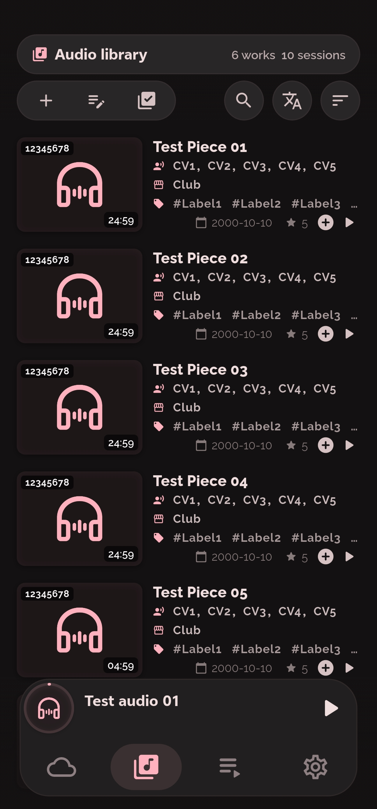
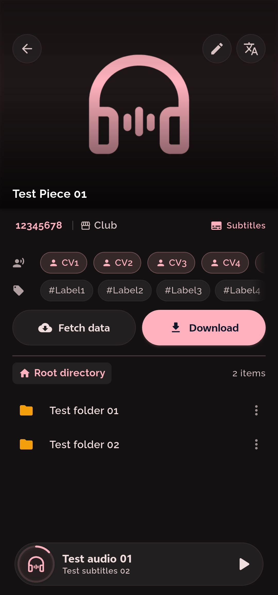
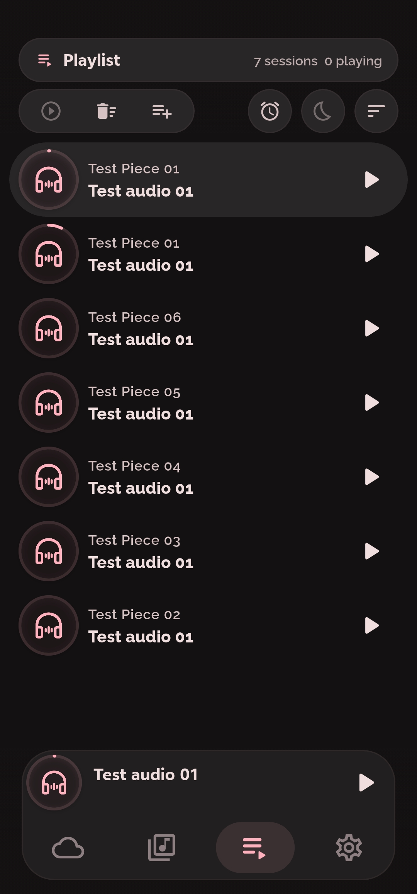
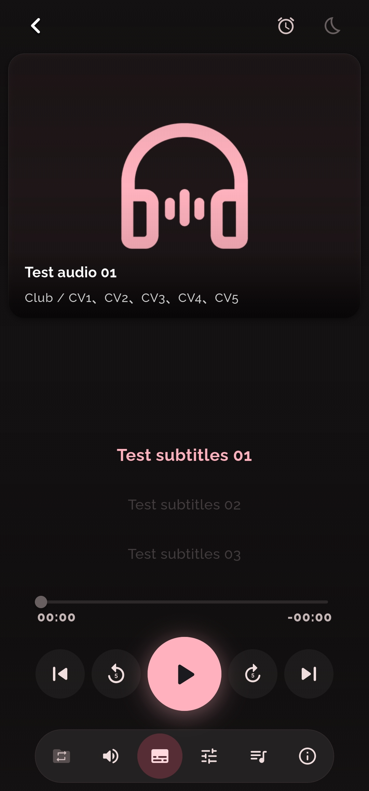
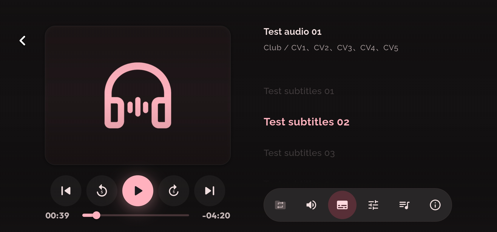

<p align="center">
  
</p>

# Doujin Audio

[简体中文](README.md) | English | [日本語](README.ja.md)

An Android / Windows player for ASMR, doujin audio, and local media libraries. Play local audio and video, stream and download from online work catalogs, and manage multiple playback sessions with independent positions, volume, subtitles, and audio effects.

[Download](https://github.com/NameIess-art/Doujin-Audio/releases/latest) · [Changelog](release_notes.md) · [GPL-3.0](LICENSE) · [Privacy Notice](PRIVACY.md) · [Security Notice](SECURITY.md)

[Download and installation](#download-and-installation) · [Screenshots](#screenshots) · [Main features](#main-features) · [Using Windows](#using-windows) · [Development and releases](#development-and-releases)

## Download and installation

Download an installer from [GitHub Latest Release](https://github.com/NameIess-art/Doujin-Audio/releases/latest). On Android, choose universal if you are unsure of your device's architecture. Windows supports Windows 10/11 x64, with runtime dependencies included. Each installer comes with a matching `.sha256` file.

| Platform | Installer | Compatible devices |
| --- | --- | --- |
| Android universal | `DoujinAudio-android-universal-<tag>.apk` | Includes arm64-v8a, armeabi-v7a, and x86_64; suitable when the architecture is unknown |
| Android arm64-v8a | `DoujinAudio-android-arm64-<tag>.apk` | Smaller download for most modern 64-bit Android devices |
| Android armeabi-v7a | `DoujinAudio-android-armv7-<tag>.apk` | Older 32-bit ARM Android devices |
| Android x86_64 | `DoujinAudio-android-x64-<tag>.apk` | x86_64 tablets, emulators, and compatible devices |
| Windows x64 | `DoujinAudio-windows-x64-<tag>-setup.exe` | Windows 10/11; installs for the current user |

Official releases are distributed only through GitHub Releases. App-store AAB packages and an iOS version are not provided. The current version is defined in [`pubspec.yaml`](pubspec.yaml).

> **Upgrading from older versions:** The current Android application ID is `com.doujin.audio`. It installs as a separate application and cannot replace versions from before the rename or inherit their private data. Restoring a `.dabackup` requires a compatible platform and format, and its database version must not exceed the application's supported version. Data and older backup formats from before the rename are not migrated automatically.

### Getting started

1. Install the package for your platform. If Android blocks installation, allow the browser or file manager opening the APK to install unknown applications. On Windows, follow the wizard to install for the current user.
2. Add a media folder, subfolder, or individual file in the local audio library. Android uses the SAF system picker for authorization; Windows uses local folders.
3. Select a work to view its details, or select an audio/video entry to play it. You can also browse ASMR.ONE and Japanese ASMR resources in the online library; ASMR.ONE account sync features require sign-in.
4. On Android, long-press selectable items in the local library or playlists to enter multi-select, or swipe left on playback queue entries to open edit actions. In the online library, open a work to view its actions. On Windows, use right-click menus; in the local/online library or playlists, right-click and choose Select multiple to select the current item and continue selecting others. Closing the Windows main window keeps the application running in the tray. Choose Exit from the tray to stop playback and quit.

## Screenshots

<table>
  <tr>
    <td colspan="2" align="center" valign="top"><strong>Local audio library</strong><br></td>
    <td colspan="2" align="center" valign="top"><strong>Work details</strong><br></td>
    <td colspan="2" align="center" valign="top"><strong>Playlists</strong><br></td>
  </tr>
  <tr>
    <td colspan="2" align="center" valign="top"><strong>Playback details (portrait)</strong><br></td>
    <td colspan="4" align="center" valign="top"><strong>Playback details (landscape)</strong><br></td>
  </tr>
</table>

## Main features

### Playback and audio effects

- **Multiple sessions and custom queues:** Keep several independent sessions, each tracking its audio, position, volume, repeat mode, subtitles, and effects. Name, sort, drag to reorder, and color queues; pause, resume, or remove sessions in batches. Saved sessions can be pinned, and temporary sessions can be included in a multi-selection.
- **Six playback modes:** Repeat one track, play the current folder in order or shuffle it, play across folders in order or shuffle them, or stop after one track. Removing the current track from its queue lets it play until it ends or you switch tracks manually.
- **Playback controls:** Play/pause, previous/next track, fast-forward/rewind, precise seeking, and retry after failure, with feedback while loading or buffering.
- **Audio adjustments** include EQ presets and band gains, silence skipping, light noise reduction, dynamic volume balancing, channel swap and balance, and pitch-preserving speed control from 0.25x–3.0x. Android uses native EQ and Windows uses software EQ. For stereo tracks, the channel balance page also adjusts virtual front/rear position over headphones. [MIT KEMAR measurement data](assets/audio/KEMAR.md)
- **Timeline markers:** Name and color points or segments, and loop a selected range. Markers can be saved with local metadata and backups.
- **Video playback:** Watch video on the playback details page, with fullscreen, screen-off audio playback, and an Audio only mode.

### Subtitles and scripts

- Automatically match same-name subtitles or associate them manually. Supports `.srt`, `.ass`, `.ssa`, `.vtt`, and `.lrc`. Playback details, the mini-player, and the system overlay display subtitles together, with timing adjustments, full-timeline browsing, and tap-to-seek.
- Drag subtitle overlays and customize their font, size, color, background opacity, and outline. Android requires overlay permission; Windows uses a separate always-on-top window.
- Importing local subtitles renames and moves the selected file beside the audio. If a subtitle file already exists, the app asks before replacing it. Add, edit, or delete cues, undo deletions, and check for overlapping times before saving in the original format, including through Android SAF.
- Transcribe local Japanese audio without a script offline into a same-name `.srt` subtitle (confirming before replacing an existing primary subtitle), or manually select a Japanese `.txt` / `.md` script to match against audio and generate a timed `.lrc`. A `.txt` with valid timestamps can be imported directly. Japanese subtitles are translated into Chinese or English via the Google public online interface without downloading or using a local translation model, preserving timestamps and saving as a bilingual "original + translation" SRT.
- Each translation is saved separately as `<full-audio-filename>.translated.<target-language>.srt` (`zh-CN` for Chinese, `en` for English), appending `.2`, `.3`, etc. on name collisions while leaving the original subtitle and other translations untouched. "Select subtitle" in the subtitle menu switches between the original subtitle and each translation and remembers the choice per audio track; a newly succeeded translation is activated automatically.
- Subtitle translation explicitly sets Japanese as the source language and preserves multi-line originals; each cue is translated as a complete block within request length limits. Newly generated SRT translations carry original-text boundary markers hidden from in-app display so re-translation only processes the original text rather than re-translating previous translations. Editing a generated bilingual subtitle edits the original and translated lines separately while preserving those boundaries.
- Recognition and translation results are saved beside local audio; results for online audio are stored in the application data directory. First use of speech recognition or script recognition downloads and verifies the corresponding local models on demand, and tasks support background processing, progress viewing, and resuming after interruption. **Offline speech recognition and script recognition are not currently supported on 32-bit Android, but online subtitle translation remains available.** Subtitle translation sends source text to Google and requires network access, so availability depends on network connectivity, rate limits, and service changes; failures or cancellations do not overwrite existing subtitles.

### Local media library

- **Folders and organization** — Preserve folder hierarchies and organize works by voice actor, tags, release date, time added, or title. Filter by duration, search with multiple keywords, pin entries, drag to reorder, and add items to queues in batches.
- **Folder authorization:** Android uses persistent SAF authorization and also supports direct-path scans and single-file imports. Windows uses local folders. Scans update the library in batches.
- **Covers:** Extract covers from folder images, embedded audio artwork, or video frames. Prefer a file's own cover or select one manually. Duplicate embedded covers are deduplicated; WAV APIC covers are supported.
- **Work attachments:** Read `.txt`, `.md`, and `.pdf` scripts and documents on the details page. Open the text viewer's top-right menu to browse files, change the encoding or font size, or copy the full text. PDFs offer paged previews.
- **Page translation:** Translate titles, circles, tags, directory structures, and file names from the top-right corner of local and ASMR.ONE work detail pages; translate loaded TXT and Markdown text from the top-right corner of the text viewer while preserving formatting, links, and code blocks (PDF translation is not supported). The target language follows the app language; tap again to revert to the original text, and in-progress requests can be cancelled. Translations only change the display without altering work metadata, file paths, or source files. Uses Google public online translation without requiring an API key; text to be translated is sent to Google, and availability depends on network connectivity, rate limits, and service adjustments.
- **DLsite metadata:** Look up work information by RJ code, filename, or title across DLsite, ASMR.ONE, and Japanese ASMR in order. If an earlier source fails or still leaves fields missing, later sources fill only the missing fields and queries stop once metadata is complete. Match works in batches, review them individually, edit results, and confirm before saving. Local works with an RJ code can open the online library download page directly to add missing files to the current work folder.
- **Removal and restoration:** Undo a library removal. Removed folders are skipped in future scans and can be restored from Removed folders.
- **LAN sharing and WebDAV remote sources:** Windows can enable an optional LAN streaming server in Settings (with 6-digit access code protection, remote-edit permission toggle, and same-subnet UDP discovery) so phones can directly browse and stream organized works, covers, external subtitles, scripts, and audio/video without scanning; both platforms can switch seamlessly between the local library, Windows LAN sources, and WebDAV folders (such as NAS or alist) from the top-right source menu in the Local library header with shared search and sorting, multi-select batch actions, real-time remote metadata/folder/review editing, and downloading remote works into the local library.

Work information is stored in `doujin-audio.json` inside the folder, including the chosen cover, timeline markers, and segment loops. Scan imports and RJ-code completion do not rewrite existing JSON. Automatic duration completion updates only missing durations, preserving other fields and entries; unreadable or incompatible files remain unchanged. Folder-work markers use relative track paths for restoration after moves, and repeated imports retain newer markers.

### Online library and downloads

- Browse and search ASMR.ONE and Japanese ASMR on a single page without choosing a source; works with the same code are merged with ASMR.ONE preferred. Added, latest, and recommended lists aggregate both sites, while sales, rating, and review rankings use ASMR.ONE metrics. Favorites and history are managed locally together, with ASMR.ONE content synchronized after sign-in.
- Japanese ASMR search and catalogs are fetched through Eara (`earaasmr.com`), while playback and downloads connect directly to the media site. Third-party endpoints may change or become temporarily unavailable; if one site fails, a notice is shown and results from the other are kept. Because this endpoint only provides release order, Japanese ASMR participates in "Added time" sorting using the added date of loaded batches and does not guarantee cross-page site-wide added order.
- Popular voice actors and tags on the search page use Eara's popular suggestions endpoint, showing cached or bundled snapshots immediately and refreshing in the background; each section shows three rows by default and expands to up to 30 items.
- Japanese ASMR streams by chapter with progress and track switching. Downloads resolve the source file page and actual URL with limited retries on network failure, and fall back to HLS saved as M4A when the source file remains unavailable. "Size unknown" is shown when the endpoint omits file size, and the actual size is recorded upon completion. Paused HLS chapters re-download the incomplete chapter rather than reusing partial remuxed files.
- Download individual tracks, subfolders, or complete works while preserving the original folder structure. Covers are saved separately to `Cover/<RJ code>.<extension>`. Android uses SAF download folders; Windows uses local folders.
- Pause individual tasks or all downloads, resume interrupted transfers, and retry failures. Download 1–5 works concurrently and set a retry limit of 3–10 attempts (default 5). Tasks are suspended when entering the background or before exit, then continue on resumption.
- The task list has controls to pause or resume all downloads. Clearing completed tasks removes their records and keeps their files. If a work is already queued, you can jump directly to the task list.
- Resuming downloads only reuses temporary files verified to belong to the same remote version; unverifiable legacy partial files are re-downloaded. Auto-caching during playback is enabled only after a complete download passes length verification, and legacy auto-caches are regenerated; completed user downloads are not rebuilt in batches.
- When saving work metadata is enabled, download tasks reuse the DLsite → ASMR.ONE → Japanese ASMR lookup and gap-filling flow by RJ code, following the work-metadata language setting; if all lookups fail or there is no RJ code, online catalog data is preserved without interrupting media downloads. New `doujin-audio.json` files are created before writing media files, and existing JSON files remain untouched.
- Completed work downloads automatically refresh already-added libraries. **Download folders are not automatically added to the library**; works outside it require manual import.

### Timers and background playback

- Adjust an active countdown by 5 or 15 minutes in either direction. In bedtime mode, double-tap to pause or resume playback and hold the screen for two seconds to exit.
- After setting a countdown, you can enable "Pause sessions after playback ends" so each playback session pauses when its current track finishes once the timer expires. Supports fade-out before pausing, automatic resumption at a preset time, and fade-in on resume.
- Android uses a native foreground media service for background and screen-off playback. The system media notification provides playback controls. The app can retry recoverable playback errors and restore pending timers after reboot.
- Android Doze and manufacturer background restrictions can still affect long listening sessions. Review battery optimization and background permissions under Permissions and background. WakeLocks cannot bypass system restrictions.
- Windows restores pending timer tasks through the current user's Task Scheduler. Waking from sleep depends on hardware and power policy. **Waking from shutdown and playback while signed out are not supported.**

### My: listening statistics, history, and interests

Both the bottom menu and the landscape sidebar provide separate My and Settings entries after Playlists. Settings → General → Page display allows hiding My. Either visible My or Settings page can be set as the startup page. Bottom menu buttons share the available width equally.

- **Listening time**: View actual listening time across local and online works by day, week, month, quarter, or year. Simultaneous sessions count once; pauses and buffering do not count, and playback speed does not multiply elapsed time. Older history is not used to invent past listening totals.
- **Bar chart and heatmap**: Switch styles on the right of the date row; the last choice is remembered. The heatmap fills the available area with seven rows of larger cells, with the latest period at the bottom right. Color intensity follows the theme and increases with listening time.
- **Dates and exact durations**: Click the date to enter a selection and scroll horizontally through past periods. Select a bar or cell to see its date range and exact duration. Windows also supports hover details, mouse dragging, wheel scrolling, and trackpad scrolling.
- **Listening history**: Local and online works appear in a vertical list, ten per page, with the most recent first. Select the page number to jump within the displayed range. Swipe left on Android or right-click on Windows to delete an entry, then use Undo to restore it. Listening totals are preserved. Selecting an entry opens the work details and prioritizes an available local copy. Local titles follow the local-name display setting.
- **Interests (Tags, Voice Actors, Circles)**: Switch between Tags, Voice Actors, and Circles tabs on the My page to view the top 20 entries and tap any item to copy its name. When tags have fewer than 20 entries, confirmed manual tags are appended to the auto-selected list and retain their manual selection state even if pushed out by other tags. Manual selections have no limit and feed into recommendation preferences once confirmed.
- **Uninterested exclusions**: Select or deselect tags, voice actors, and circles to exclude on each management page, hiding matching works across online library lists. Existing favorites, history, downloads, and active playback are retained, including history in My. Complete metadata supports offline search and batch saving.

### Personalization and data maintenance

- **Network services**: Test DLsite, ASMR mirrors, and Japanese ASMR; choose a mirror. System/VPN, HTTP, SOCKS5 (with optional authentication), and custom DNS apply to in-app requests, including streaming, downloads, updates, and translation. New connections use changed settings while current tasks continue. Proxy passwords remain encrypted on the device and are excluded from preference backups.
- Choose light, dark, or system theme, pure black theme, frosted menu bars, a theme color, the startup page, transition speed, reduced motion, and cover decoding quality. The interface supports Simplified Chinese, English, and Japanese.
- On Android, configure behavior after headphone disconnection, temporary audio-focus loss, or calls, and choose exclusive audio focus or mixing with other applications.
- `.dabackup` uniformly backs up the library, settings, playback history and sessions, timeline markers, and ASMR.ONE credentials. On import, integrity and database schema version are validated first: on the same platform you can choose between a cold-start full restore (with rollback on failure and preservation of newer local listening stats, history, and interests in My) or an instant no-restart incremental merge; across platforms (Windows ↔ Android) it automatically performs an instant incremental merge keyed by `RJ code + relative track path` for playback positions, track favorites, work listening statuses and reviews, idempotent per-device listening durations, timeline markers, and interest preferences, with an option to also sync your ASMR.ONE account and portable settings while skipping local paths and folder permissions. Exported backups may contain unencrypted ASMR.ONE credentials.
- Persistent cover caching supports offline access and survives restarts, with no automatic eviction by age or capacity. Lists, filters, pagination, and browsing positions are retained only during the current run; reopening details loads the file tree again.
- Android provides storage analysis and selective cache cleanup. Windows hides mobile settings such as Permissions and background, Cache, and Storage space; internal caches still serve playback and downloads. Cleanup preserves source files, manually chosen covers, favorites, history, and playback state.
- Export diagnostic reports with sensitive account information removed to help report problems.
- **Automatic cross-platform sync:** Alongside manual `.dabackup` import/export, pulling down to refresh a remote library automatically performs bidirectional progress and stats sync over LAN, and optional WebDAV per-device shards (`.dasync`) auto-sync on startup and backgrounding.

## Supported formats

| Type | Formats |
| --- | --- |
| Audio | `flac`, `wav`, `mp3`, `m4a`, `aac`, `ogg`, `opus`, `3gp` |
| Video | `mp4`, `mkv`, `webm`, `mov`, `m4v`, `avi`, `3gp` |
| Subtitles | `.srt`, `.ass`, `.ssa`, `.vtt`, `.lrc` |
| Documents | `.txt` (encoding detection), `.md`, `.pdf` |
| Covers | `jpg`, `jpeg`, `png`, `webp`, embedded audio artwork, video frames |
| Backups & Sync | `.dabackup` (same-platform full restore / cross-platform incremental merge) |

## Using Windows

The main interface uses a landscape layout, with a default client area of 1280×800 and a minimum of 960×600 logical pixels. Windows can be resized and maximized. Use right-click menus for card actions and to copy metadata tags. Vertical pages have always-visible scrollbars. Subtitle overlays remain visible with the main window in the foreground or background. They can be dragged and resized horizontally, with automatic text wrapping and height adjustment. Position and width are saved across restarts.

Closing the main window minimizes to the tray. Exit from the tray saves data and ends the process. The application provides a single instance, system media controls, handling of audio-output-device changes, and taskbar thumbnail playback buttons. Upgrades preserve user data; uninstallation removes scheduled tasks but retains the user data directory.

Press `F1` to view keyboard help and global shortcut registration status:

| Scope | Keys | Action |
| --- | --- | --- |
| System-wide (including background and tray) | `Ctrl+Alt+Space` | Play / pause |
| System-wide | `Ctrl+Alt+←` / `→` | Previous / next track |
| System-wide | `Ctrl+Alt+↑` | Restore main window |
| Application foreground | `Ctrl+Space` | Play / pause |
| Application foreground | `Ctrl+←` / `→` | Previous / next track |
| Application foreground | `Alt+←` / `→` | Seek backward / forward 5 seconds |
| Application foreground | `↑` / `↓` | Increase / decrease the controlled session's volume by 5% |
| Main interface | `Ctrl+1` through `Ctrl+4` | Switch navigation pages in displayed order |
| Main interface | `Ctrl+Tab` / `Ctrl+Shift+Tab` | Next / previous page |
| Controls and menus | `Tab` / `Shift+Tab`, `Enter` | Move focus and activate controls |
| Cards | `Shift+F10` or the menu key | Open actions |
| Menus and pages | `↑` / `↓`, `Esc` | Select items, close menus, or go back |

Text fields retain their editing keys. Space first activates a focused button and controls playback if no control consumes it. Global shortcuts claimed by another application appear as unavailable in help. Playback commands use the same session-selection rules as system media controls.

## In-app updates and privacy

Check GitHub Latest Release automatically at startup or manually from settings. The application selects an installer for the platform and CPU architecture, displays download progress, and launches the Android system installer or Windows installation wizard **only after SHA-256 verification passes**. Android chooses universal if the architecture is unknown. Windows chooses the x64 installer and requests that the player exit when you confirm installation in the wizard.

Library indexes, settings, and playback state are stored locally on the device. Network access is used for online work catalogs (ASMR.ONE and Eara's Japanese ASMR catalog with corresponding media sites), DLsite metadata, GitHub updates, the initial download of script-recognition models, and user-initiated page and subtitle translation. Online subtitles are cached locally before loading. Permissions such as file access and overlays are requested when their features are used. See the [Privacy Notice](PRIVACY.md) for details.

### Android permissions

| Permission | Purpose |
| --- | --- |
| `READ_MEDIA_AUDIO` / `READ_EXTERNAL_STORAGE` | Direct filesystem scans and traditional file selection |
| `MANAGE_EXTERNAL_STORAGE` | Optional full-storage access; not required for SAF |
| `FOREGROUND_SERVICE_MEDIA_PLAYBACK` / `WAKE_LOCK` | Background and screen-off playback |
| `SYSTEM_ALERT_WINDOW` | System subtitle overlay |
| `SCHEDULE_EXACT_ALARM` / `RECEIVE_BOOT_COMPLETED` | Exact timers and task restoration after reboot |
| `REQUEST_INSTALL_PACKAGES` | Launch the system installer after downloading updates |
| `INTERNET` | Online content, metadata queries, and updates |

## Development and releases

Flutter provides shared UI and business logic. Android playback uses Media3 / ExoPlayer; Windows uses media_kit / libmpv. Code is organized by responsibility:

| Path | Responsibility |
| --- | --- |
| `lib/app/` | Startup, dependency assembly, routing, global state, themes, and language |
| `lib/core/` | Persistence, platform gateways, shared media models, and reusable components |
| `lib/features/` | Library, Player, ASMR, Settings, and Data Support, separated into `domain` / `application` / `presentation` |
| `android/` | Playback service, channels, scanning, storage, metadata, subtitles, and updates |
| `windows/runner/desktop/` | Windows, tray, system media controls, subtitle overlays, and scheduled tasks |
| `test/`, `integration_test/` | Unit, widget, and platform integration tests |
| `tool/` | Validation, dependency preparation, builds, and installer scripts |

### Local verification

```powershell
flutter pub get
flutter analyze
flutter test
$tag = dart tool/verify_release.dart --print-tag
dart run tool/verify_release.dart --tag $tag
```

### Android Release builds

Configure `android/key.properties` and its keystore before building. Missing official signing information stops the build; it does not fall back to debug signing.

```powershell
flutter build apk --release --obfuscate --split-debug-info=build/app/outputs/symbols
flutter build apk --release --split-per-abi --target-platform android-arm,android-arm64,android-x64 --obfuscate --split-debug-info=build/app/outputs/symbols
```

### Windows builds

Install Flutter 3.41.6, Visual Studio's Desktop development with C++ workload, and the Windows SDK, then run:

```bat
tool\build_windows.bat
```

The unified script works from any working directory, downloads and verifies pinned versions of media tools and Inno Setup, then builds Release and outputs the installer and `.sha256` to `dist/windows/`. The installer includes required DLLs, Flutter assets, and media tools; copying only the main EXE is insufficient. Windows code signing is not configured by default.

Before running `flutter run -d windows` directly, run `tool\build_windows.bat -PrepareOnly` to prepare media tools. `-SkipBuild` only reuses an existing Release build and does not replace build verification. Debug and installed builds each maintain their own single instance, with debug scheduled tasks also isolated from the installed application.

### GitHub Release

[GitHub Actions](.github/workflows/flutter.yml) runs static analysis, the full Flutter test suite, Android JVM tests, validation builds for both platforms, and official packaging. Official Releases include Android universal, arm64, armv7, and x64 APKs plus a Windows x64 installer. Each asset has a matching `.sha256` file.

Before creating a tag, ensure the version matches `pubspec.yaml` and wait for all main-branch CI checks to pass for the corresponding commit:

```powershell
$tag = dart tool/verify_release.dart --print-tag
dart run tool/verify_release.dart --tag $tag
git push origin main
# Wait for all main-branch CI checks to pass for this commit before creating and pushing the tag.
git tag $tag
git push origin $tag
```

The tag workflow builds Android assets with official signing keys, verifies signatures, ABIs, and checksums, and generates the Windows installer. Once all required checks and builds pass, the workflow creates a draft Release, verifies the complete set of assets, and publishes it. See the [current release notes](release_notes.md) and [past releases](https://github.com/NameIess-art/Doujin-Audio/releases).

## Support the project

Support ongoing maintenance through [Aifadian](https://ifdian.net/a/nameIess). Sponsorship is entirely voluntary and does not unlock privileges or paid features. All features remain free.
