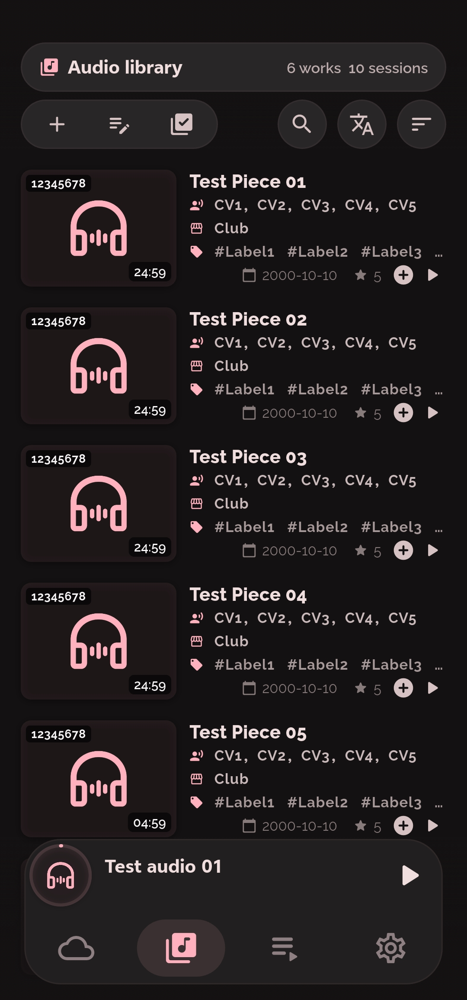
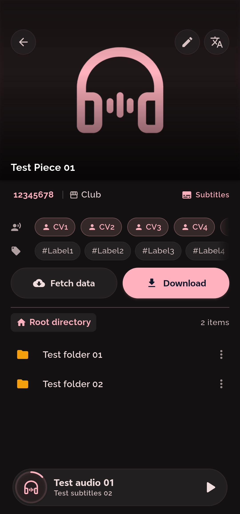
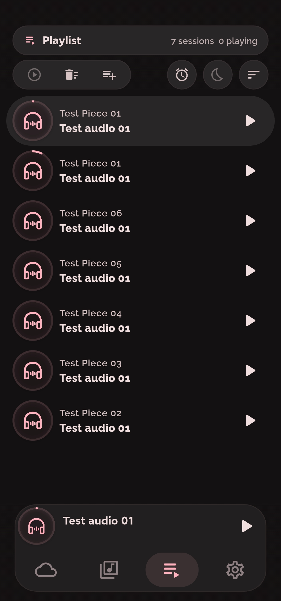
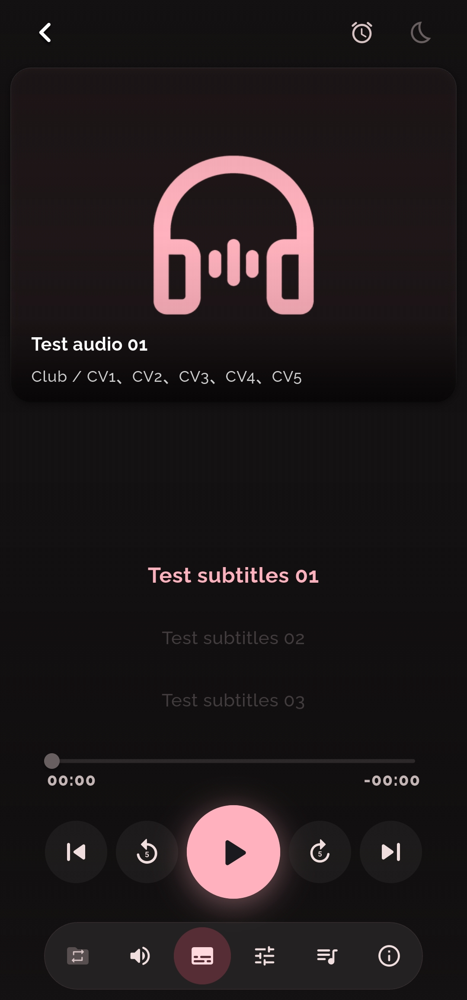
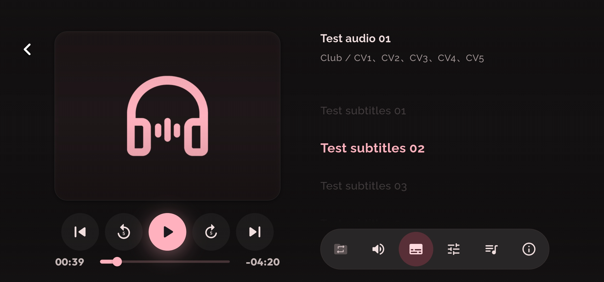

<p align="center">
  
</p>

# Doujin Audio

[简体中文](README.md) | [English](README.en.md) | 日本語

ASMR、同人音声、ローカルメディアライブラリ向けの Android / Windows プレーヤーです。ローカルの音声・動画やオンライン作品庫の再生・ダウンロードに対応し、複数の再生セッションで再生位置、音量、字幕、音声効果を個別に管理できます。

[ダウンロード](https://github.com/NameIess-art/Doujin-Audio/releases/latest) · [変更履歴](release_notes.md) · [GPL-3.0](LICENSE) · [プライバシー](PRIVACY.md) · [セキュリティ](SECURITY.md)

[ダウンロードとインストール](#ダウンロードとインストール) · [スクリーンショット](#スクリーンショット) · [主な機能](#主な機能) · [Windows の使い方](#windows-の使い方) · [開発とリリース](#開発とリリース)

## ダウンロードとインストール

[GitHub Latest Release](https://github.com/NameIess-art/Doujin-Audio/releases/latest) からインストーラーをダウンロードしてください。Android で端末のアーキテクチャが不明な場合は universal を選べます。Windows は Windows 10/11 x64 に対応し、実行に必要なファイルを同梱しています。各パッケージには同名の `.sha256` 検証ファイルが付属します。

| プラットフォーム | パッケージ | 対象端末 |
| --- | --- | --- |
| Android universal | `DoujinAudio-android-universal-<tag>.apk` | arm64-v8a、armeabi-v7a、x86_64 を含む。アーキテクチャが不明な場合におすすめ |
| Android arm64-v8a | `DoujinAudio-android-arm64-<tag>.apk` | 大部分の現行 64 ビット Android 端末向け。ファイルサイズが小さい |
| Android armeabi-v7a | `DoujinAudio-android-armv7-<tag>.apk` | 旧型の 32 ビット ARM Android 端末向け |
| Android x86_64 | `DoujinAudio-android-x64-<tag>.apk` | x86_64 タブレット、エミュレーター、対応端末向け |
| Windows x64 | `DoujinAudio-windows-x64-<tag>-setup.exe` | Windows 10/11。現在のユーザー向けにインストール |

公式配布は GitHub Release のみです。アプリストア向けの AAB や iOS 版は提供していません。現在のバージョンは [`pubspec.yaml`](pubspec.yaml) で確認できます。

> **旧バージョンからの更新：** 現在の Android アプリ ID は `com.doujin.audio` です。独立したアプリとしてインストールされるため、名称変更前の版の上書きやプライベートデータの引き継ぎはできません。`.dabackup` の復元にはプラットフォームと形式の互換性が必要で、バックアップのデータベースバージョンはアプリが対応するバージョン以下である必要があります。名称変更前のデータや旧形式のバックアップは自動移行しません。

### 初めて使うとき

1. 対応するプラットフォームのパッケージをインストールします。Android で制限が表示される場合は、APK を開くブラウザーやファイルマネージャーに「不明なアプリのインストール」を許可してください。Windows はウィザードに従って現在のユーザー向けにインストールします。
2. 「ローカル音声ライブラリ」でフォルダー、サブフォルダー、単一ファイルを追加します。Android は SAF のシステム選択画面でアクセスを許可し、Windows はローカルフォルダーを選びます。
3. 作品をクリックすると詳細を開き、音声や動画の項目をクリックすると再生します。オンライン作品庫で ASMR.ONE と Japanese ASMR のリソースも閲覧できます。ASMR.ONE のアカウント同期機能にはログインが必要です。
4. Android ではローカル作品庫やプレイリストの選択可能な項目を長押しして複数選択に入り、再生キューの項目を左スワイプして編集操作を開けます。オンライン作品庫は作品を開いて操作を確認できます。Windows は右クリックメニューで操作し、ローカル／オンラインライブラリやプレイリストで右クリックして「複数選択」を選ぶと、その項目を選択して他の項目も追加選択できます。Windows はメインウィンドウを閉じてもトレイで動作します。再生を終了してアプリを閉じるには、トレイの「終了」を選んでください。

## スクリーンショット

<table>
  <tr>
    <td colspan="2" align="center" valign="top"><strong>ローカル音声ライブラリ</strong><br></td>
    <td colspan="2" align="center" valign="top"><strong>作品詳細情報</strong><br></td>
    <td colspan="2" align="center" valign="top"><strong>プレイリスト</strong><br></td>
  </tr>
  <tr>
    <td colspan="2" align="center" valign="top"><strong>再生詳細（縦画面）</strong><br></td>
    <td colspan="4" align="center" valign="top"><strong>再生詳細（横画面）</strong><br></td>
  </tr>
</table>

## 主な機能

### 再生と音声効果

- **複数セッションとカスタムキュー**：独立した複数のセッションで、トラック、再生位置、音量、リピートモード、字幕、音声効果を個別に保持します。キューの名前、並べ替え、ドラッグによる順序変更、配色を設定でき、一括で一時停止、再開、削除できます。保存済みのセッションはピン留めでき、一時セッションも複数選択に含められます。
- **6 種類の再生モード**：1 曲リピート、現在のフォルダー内の順次・ランダム再生、フォルダーをまたぐ順次・ランダム再生、1 曲の終了後に停止。再生中のトラックをキューから削除しても、最後まで再生するか手動で曲を切り替えるまで再生を継続します。
- **再生操作**：再生・一時停止、前の曲・次の曲、早送り・早戻し、細かいシーク、失敗時の再試行に対応し、読み込みやバッファリングの状態も表示します。
- **音声調整**では、EQ プリセットと帯域別ゲイン、無音スキップ、軽いノイズ低減、動的な音量バランス、左右チャンネルの入れ替えとバランス調整に対応します。ピッチを保持した 0.25x–3.0x の速度変更も可能です。Android はネイティブ EQ、Windows はソフトウェア EQ を使用します。ステレオ音源の再生時は、チャンネルバランス画面でヘッドホンの前後定位も調整できます。 [MIT KEMAR の測定データ](assets/audio/KEMAR.md)
- **タイムラインマーカー**：時刻や区間に名前と色を付けて、区間リピートを設定できます。マーカーはローカルメタデータやバックアップに保存できます。
- **動画再生**：再生詳細ページで動画を表示し、全画面、画面消灯時の音声再生、「音声のみ再生」モードを利用できます。

### 字幕と台本

- 同名字幕の自動照合と手動の関連付けに対応し、`.srt`、`.ass`、`.ssa`、`.vtt`、`.lrc` を使用できます。再生詳細、ミニプレーヤー、システムの字幕オーバーレイに同期表示し、時間オフセットの調整、全文のタイムライン表示、クリックによるシークができます。
- 字幕オーバーレイはドラッグでき、フォント、サイズ、色、背景の透明度、縁取りを設定できます。Android はオーバーレイ権限、Windows は独立した最前面ウィンドウを使用します。
- ローカル字幕の取り込みでは、選択したファイルを名前変更して音声と同じフォルダーに移動します。既存字幕がある場合は上書きを確認します。字幕行の追加・編集・削除と削除の取り消しができ、時間の重複を確認してから元の形式で保存します。Android SAF にも対応します。
- 日本語の `.txt` / `.md` 台本を手動で選び、音声と照合して `.lrc` タイムラインを生成できます。有効なタイムラインを含む `.txt` は直接取り込めます。日本語字幕は Google の公開オンラインインターフェースで中国語や英語へ翻訳でき、ローカル翻訳モデルのダウンロードや使用は不要で、タイムラインを保持したまま「原文＋訳文」の SRT として保存します。
- 翻訳のたびに `<完全な音声ファイル名>.translated.<対象言語>.srt`（中国語は `zh-CN`、英語は `en`）として個別に保存し、同名ファイルがある場合は `.2`、`.3` などの連番を付与して、元の字幕や他の訳文は変更しません。字幕メニューの「字幕を選択」から元の字幕と各訳文を切り替えられ、音声ごとに選択を記憶します。翻訳成功時は新しい訳文を自動で有効化します。
- 字幕翻訳では日本語を翻訳元言語として明示し、複数行の原文を保持します。各字幕はリクエスト長の上限内でまとまったテキストとして翻訳します。新しく生成される訳文 SRT にはアプリ内の字幕表示に含まれない原文境界マーカーを保持し、再翻訳時は原文のみを処理して過去の訳文を二重翻訳しません。生成された二言語字幕を編集する際も原文と訳文を分けて修正でき、原文境界を維持します。
- 認識・翻訳結果はローカル音声と同じフォルダーに保存し、オンライン音声の結果はアプリのデータフォルダーに保存します。台本認識は初回使用時にローカル CTC モデルをダウンロードして検証し、バックグラウンド処理、進捗確認、中断後の再開に対応します。**32 ビット Android は台本認識に現在非対応ですが、オンライン字幕翻訳は利用できます。** 字幕翻訳は原文を Google へ送信するためインターネット接続が必要で、可用性はネットワーク・レート制限・サービス変更の影響を受けます。失敗やキャンセル時も元の字幕は上書きしません。

### ローカルメディアライブラリ

- **フォルダーと分類**：フォルダー階層を保持し、声優、タグ、再生時間、発売日、追加日時、タイトルで分類・並べ替えができます。複数キーワードの検索、ピン留め、ドラッグによる並べ替え、キューへの一括追加に対応します。
- **フォルダーのアクセス許可**：Android は SAF の永続的な許可を使用し、直接パスのスキャンと単一ファイルの取り込みにも対応します。Windows はローカルフォルダーを使用します。スキャンはバッチごとにライブラリを更新します。
- **カバー管理**：フォルダーの画像、音声の埋め込み画像、動画フレームからカバーを抽出できます。ファイル自身のカバーの優先表示や手動選択ができ、埋め込み画像の重複除去と WAV APIC カバーに対応します。
- **作品の添付ファイル**：詳細ページで `.txt`、`.md`、`.pdf` の台本や文書を閲覧できます。テキストビューアー右上のメニューから、ファイル一覧の表示、文字コードや文字サイズの変更、全文のコピーができます。PDF はページ別プレビューに対応します。
- **ページ翻訳**：ローカルおよび ASMR.ONE 作品詳細ページの右上からタイトル、サークル、タグ、ディレクトリーおよびファイル名を翻訳できます。テキストビューアーの右上からは読み込み済みの TXT および Markdown 本文を翻訳でき、Markdown の体裁、リンク、コードを保持します（PDF は非対応）。翻訳先言語はアプリの表示言語に連動し、再度タップすると原文に戻り、処理中のキャンセルも可能です。表示のみを変更し、作品情報やパス、元ファイルを書き換えません。API キー不要の Google 公開オンラインインターフェースを使用し、翻訳対象テキストは Google へ送信され、可用性はネットワーク、レート制限、サービス状況に依存します。
- **作品メタデータ**：RJ 番号、ファイル名、タイトルで作品情報を検索し、DLsite、ASMR.ONE、Japanese ASMR を順に参照します。前のソースで失敗または項目不足がある場合は後続のソースで不足分のみを補完し、情報が揃った時点で照会を終了します。一括照合、作品ごとの確認、編集後の保存に対応します。RJ 番号のあるローカル作品からオンライン作品庫のダウンロードページを開き、現在の作品フォルダーへファイルを追加できます。
- **ライブラリからの削除と復元**：削除時には取り消し操作を提供します。削除したフォルダーは以後のスキャンで無視され、「削除済みフォルダー」から復元できます。

作品情報はフォルダー内の `doujin-audio.json` に保存し、選択したカバー、タイムラインマーカー、区間リピートを含みます。スキャンによる取り込みと RJ 番号の補完では既存の JSON を書き換えません。再生時間の自動補完は空欄だけを更新し、その他のフィールドや項目を保持します。読み取れない場合や形式に互換性がない場合も元のファイルを保持します。フォルダー作品のマーカーはトラックの相対パスを使い、移動後も復元しやすくします。重複取り込みでは新しいマーカーを保持します。

### オンライン作品庫とダウンロード

- 同じページで ASMR.ONE と Japanese ASMR をソース切り替えなしで閲覧・検索でき、同一番号の作品は ASMR.ONE を優先して統合します。収録・新着・おすすめは両サイトを集約し、販売数・評価・レビュー順位は ASMR.ONE の実指標を使用します。お気に入りと履歴はローカルで一括管理し、ASMR.ONE の内容はログイン後に同期できます。
- Japanese ASMR の検索と一覧は Eara サービス（`earaasmr.com`）経由で取得し、再生とダウンロードはメディアサイトへ直接接続します。サードパーティの API は変更や一時的な停止が起こる場合があり、片方のサイトで失敗しても通知のうえもう片方の結果を保持します。現状この API は発売順のみを提供するため、「収録日時」ソートでは読み込み済みバッチの収録日で並び替えを行い、ページをまたいだサイト全体の収録順は保証しません。
- 検索ページの人気声優・タグは Eara の人気候補 API を使用し、表示時はキャッシュまたは同梱スナップショットを先に表示してバックグラウンドで更新します。各欄は既定で 3 行表示し、展開時は最大 30 件まで表示します。
- Japanese ASMR はチャプター単位でオンライン再生、進捗表示、トラック切り替えが可能です。ダウンロード時は元ファイルページと実 URL を解析し、ネットワーク失敗時は限定的にリトライしたうえで、元ファイルを取得できない場合は HLS を取得して M4A として保存します。API がサイズを返さない場合は「サイズ不明」と表示し、完了後に実ファイルサイズを記録します。HLS チャプターを一時停止した場合は不完全なリマックス済みファイルを再利用せず、そのチャプターを再ダウンロードします。
- 単一トラック、サブフォルダー、作品全体をダウンロードし、元のフォルダー構造を保持します。カバーは `Cover/<RJ番号>.<拡張子>` に別途保存します。Android は SAF のダウンロード先、Windows はローカルフォルダーを使用します。
- 個別・全体の一時停止、途中からの再開、失敗時の再試行に対応します。同時ダウンロードは 1–5 作品、再試行の上限は 3–10 回（既定 5 回）に設定できます。バックグラウンドへの移行時や終了前にタスクを中断し、復帰後に再開します。
- ダウンロード一覧から全タスクを一時停止・再開できます。完了済みの項目を整理すると、タスクの記録だけを削除します。登録済みの作品を再度追加した場合は、一覧へ直接移動できます。
- レジューム時は同一リモート版と検証できる一時ファイルのみを再利用し、検証できない旧形式の一時ファイルは再ダウンロードします。再生時の自動キャッシュは完全ダウンロードと長さ検証の通過後にのみ有効化され、旧版の自動キャッシュは再生成します（完了済みのユーザーダウンロードファイルは一括再構築しません）。
- 作品情報の保存が有効な場合、ダウンロードタスクは RJ 番号により DLsite → ASMR.ONE → Japanese ASMR の取得・補完フローを再利用し、言語は作品情報の言語設定に従います。すべて失敗または RJ 番号がない場合もオンライン一覧データを保持し、メディアのダウンロードを中断しません。新規 `doujin-audio.json` はメディアファイル書き込み前に作成し、既存の JSON は変更しません。
- 作品全体のダウンロード後、追加済みのライブラリを自動更新します。**ダウンロード先はライブラリに自動追加されません。** ライブラリ外の作品は手動で取り込んでください。

### タイマーとバックグラウンド再生

- 実行中のカウントダウンは 5 分または 15 分単位で増減できます。就寝モードではダブルタップで再生と一時停止を切り替え、画面を 2 秒間長押しすると終了します。
- カウントダウン設定後、「セッションの再生終了後に一時停止」を有効にできます。タイマー満了時、各再生セッションは再生中のトラックが終わった時点で一時停止します。停止前のフェードアウト、指定時刻の自動再開、再開時のフェードインに対応します。
- Android はネイティブのフォアグラウンドメディアサービスでバックグラウンド・画面消灯時の再生を維持します。システムのメディア通知から再生を操作でき、復旧可能な再生エラーの再試行や、再起動後の未完了タイマーの復元にも対応します。
- Android の Doze やメーカーのバックグラウンド制限が長時間の再生に影響する場合があります。「権限とバックグラウンド」でバッテリー最適化とバックグラウンド権限を確認してください。WakeLock でもシステムの制限は回避できません。
- Windows は現在のユーザーのタスクスケジューラで未完了タイマーを復元します。スリープからの復帰はハードウェアと電源ポリシーに依存し、**シャットダウン状態からの起動や未ログイン時の再生には対応しません。**

### マイページ：再生統計・履歴・興味

下部メニューと横画面サイドバーの両方で、「プレイリスト」の後に「マイページ」と「設定」を個別に配置します。「設定 → 一般 → ページ表示」で「マイページ」を非表示にでき、表示中の「マイページ」と「設定」はどちらも起動ページに設定できます。下部メニューのボタンは利用可能な幅を均等に分割します。

- **再生時間**：ローカル作品とオンライン作品の実際の再生時間を、日・週・月・四半期・年ごとに集計します。同時再生を重複計上せず、一時停止やバッファリング中は加算しません。倍速でも経過時間は増幅せず、古い履歴から過去の再生時間を推測しません。
- **棒グラフとヒートマップ**：日付行の右側で切り替え、前回の選択を記憶します。ヒートマップは表示領域に合わせてマスを拡大し、固定 7 行で配置します。最新の期間は右下に表示し、テーマカラーの濃淡で再生時間を表します。
- **日付と正確な時間**：日付を押すと入力して選択でき、グラフは横スクロールで過去を確認できます。棒やマスを選ぶと日付範囲と正確な再生時間を表示します。Windows はマウスホバー、ドラッグ、ホイール、タッチパッドにも対応します。
- **再生履歴**：ローカル・オンライン作品を最近の再生順に縦一覧で表示します。1 ページは 10 件で、ページ番号から表示範囲内のページに直接移動できます。Android では左スワイプ、Windows では右クリックで削除し、直後に元に戻せます。削除しても累計再生時間は変わりません。項目を選ぶと作品詳細を開き、利用できるローカル版を優先します。ローカル作品名は名前の表示設定に従います。
- **興味設定（タグ・声優・サークル）**：マイページの「タグ」「声優」「サークル」タブでよく聴く上位 20 件を確認し、タップで名前をコピーできます。タグが 20 件未満の場合、確定済みの手動タグが自動選択リストに補完され、他のタグに押し出されても手動選択状態を保持します。手動選択は件数無制限で、確定後におすすめの好みに反映されます。
- **興味のない項目の除外**：各管理ページでタグ、声優、サークルの除外を選択・解除し、該当作品をオンライン作品庫の各一覧で非表示にできます。元のお気に入り・履歴・ダウンロード・再生中の内容は保持し、マイページの履歴にも残ります。完全なメタデータはオフライン検索と一括保存に対応します。

### カスタマイズとデータ管理

- **ネットワークサービス**：DLsite、ASMR ミラー、Japanese ASMR の接続テスト、ミラーの選択に対応します。システム/VPN、HTTP、SOCKS5（任意の認証）、カスタム DNS をストリーミング、ダウンロード、更新、翻訳などのアプリ内通信に適用します。変更は新しい接続から有効になり、実行中の処理は継続します。プロキシのパスワードは端末内に暗号化して保存し、設定のバックアップには含めません。
- ライト、ダーク、システムに従うテーマを選べます。純黒テーマ、メニューバーのすりガラス効果、テーマカラー、起動ページ、画面遷移の速度、アニメーションの低減、カバーのデコード品質を設定できます。UI は簡体字中国語、英語、日本語に対応します。
- Android はヘッドホン切断、一時的なフォーカス喪失、通話終了後の動作を設定でき、排他的なフォーカスや他のアプリとのミックス再生を選べます。
- `.dabackup` でライブラリ、設定、再生履歴とセッション、タイムラインマーカー、ASMR.ONE の認証情報をバックアップできます。復元前に検証し、次のコールドスタートでデータを置き換え、失敗時は元に戻します。**同じプラットフォームでのみ復元できます。** 書き出したバックアップには、暗号化されていない ASMR.ONE の認証情報が含まれる場合があります。
- カバーの永続キャッシュは再起動後やオフラインでも読み込め、時間や容量で自動削除しません。一覧、フィルター、ページ番号、閲覧位置は実行中のみ保持し、詳細を開き直す際はファイルツリーを読み込みます。
- Android はストレージ分析と種類別のキャッシュ削除を提供します。Windows は「権限とバックグラウンド」「キャッシュ」「ストレージ容量」などのスマートフォン専用設定を表示しませんが、内部キャッシュは再生とダウンロードに使用します。削除時も元ファイル、手動選択したカバー、お気に入り、履歴、再生状態を保持します。
- アカウントの機密情報を除いた診断レポートを書き出し、不具合報告に利用できます。

## 対応形式

| 種類 | 形式 |
| --- | --- |
| 音声 | `flac`、`wav`、`mp3`、`m4a`、`aac`、`ogg`、`opus`、`3gp` |
| 動画 | `mp4`、`mkv`、`webm`、`mov`、`m4v`、`avi`、`3gp` |
| 字幕 | `.srt`、`.ass`、`.ssa`、`.vtt`、`.lrc` |
| ドキュメント | `.txt`（文字コード判定）、`.md`、`.pdf` |
| カバー | `jpg`、`jpeg`、`png`、`webp`、音声の埋め込み画像、動画フレーム |
| バックアップ | `.dabackup` |

## Windows の使い方

メイン画面は横向きレイアウトで、初期クライアント領域は 1280×800、最小は 960×600 論理ピクセルです。ウィンドウのサイズ変更と最大化に対応します。カードは右クリックメニューで操作し、メタデータのタグは右クリックでコピーできます。縦にスクロールするページには常時表示のスクロールバーがあります。字幕オーバーレイはメインウィンドウが前面・背面のどちらでも表示され、ドラッグ、幅の変更、テキストの折り返し、高さの自動調整ができます。位置と幅は再起動後も保持されます。

メインウィンドウを閉じるとトレイに入り、トレイの「終了」でデータを保存してプロセスを終了します。単一インスタンス、システムメディア操作、音声出力デバイスの変更処理、タスクバーのサムネイル再生ボタンに対応します。アップグレードはユーザーデータを保持し、アンインストールはタイマーを削除しますが、ユーザーデータのフォルダーは保持します。

`F1` でキーボード操作のヘルプとグローバルショートカットの登録状態を確認できます。

| 対象 | キー | 操作 |
| --- | --- | --- |
| システム全体（バックグラウンド・トレイを含む） | `Ctrl+Alt+Space` | 再生 / 一時停止 |
| システム全体 | `Ctrl+Alt+←` / `→` | 前の曲 / 次の曲 |
| システム全体 | `Ctrl+Alt+↑` | メインウィンドウを復元 |
| アプリが前面 | `Ctrl+Space` | 再生 / 一時停止 |
| アプリが前面 | `Ctrl+←` / `→` | 前の曲 / 次の曲 |
| アプリが前面 | `Alt+←` / `→` | 5 秒戻る / 進む |
| アプリが前面 | `↑` / `↓` | 操作対象セッションの音量を 5% 上げる / 下げる |
| メイン画面 | `Ctrl+1`～`Ctrl+4` | 表示順にナビゲーションページを切り替え |
| メイン画面 | `Ctrl+Tab` / `Ctrl+Shift+Tab` | 次のページ / 前のページ |
| コントロールとメニュー | `Tab` / `Shift+Tab`、`Enter` | フォーカスを移動して操作を実行 |
| カード | `Shift+F10` またはメニューキー | 操作メニューを開く |
| メニューとページ | `↑` / `↓`、`Esc` | メニュー項目の選択、メニューを閉じる、戻る |

テキスト入力中は編集用のキー操作を優先します。スペースはフォーカス中のボタンを優先して操作し、コントロールが使用していない場合に再生を操作します。グローバルショートカットが他のプログラムに使用されている場合、ヘルプに利用不可と表示します。再生操作とシステムメディア操作は、同じセッション選択規則を使用します。

## アプリ内更新とプライバシー

起動時または設定ページから手動で GitHub Latest Release を確認し、プラットフォームと CPU アーキテクチャに合うパッケージを選びます。ダウンロードの進捗を表示し、**SHA-256 の検証に成功した後**に Android のシステムインストーラーまたは Windows のセットアップウィザードを起動します。Android でアーキテクチャを判定できない場合は universal、Windows は x64 を選びます。Windows でインストールを確定すると、ウィザードがプレーヤーの終了を要求します。

ライブラリの索引、設定、再生状態は端末内に保存します。ネットワークはオンライン作品庫（ASMR.ONE、Eara の Japanese ASMR 一覧と対応メディアサイト）、DLsite メタデータ、GitHub 更新、台本認識モデルの初回ダウンロード、およびユーザー操作によるページ・字幕翻訳に使用します。オンライン字幕はローカルファイルへキャッシュしてから読み込みます。ファイルアクセスやオーバーレイなどの権限は、対応する機能を使用するときに要求します。詳細は[プライバシー](PRIVACY.md)を参照してください。

### Android の権限

| 権限 | 用途 |
| --- | --- |
| `READ_MEDIA_AUDIO` / `READ_EXTERNAL_STORAGE` | ファイルシステムの直接スキャンと従来のファイル選択 |
| `MANAGE_EXTERNAL_STORAGE` | 任意の全ストレージアクセス。SAF を使う場合は不要 |
| `FOREGROUND_SERVICE_MEDIA_PLAYBACK` / `WAKE_LOCK` | バックグラウンド・画面消灯時の再生 |
| `SYSTEM_ALERT_WINDOW` | システムの字幕オーバーレイ |
| `SCHEDULE_EXACT_ALARM` / `RECEIVE_BOOT_COMPLETED` | 正確なタイマーと再起動後のタスク復元 |
| `REQUEST_INSTALL_PACKAGES` | 更新ダウンロード後のシステムインストーラー呼び出し |
| `INTERNET` | オンラインコンテンツ、メタデータ照会、更新 |

## 開発とリリース

共有 UI とビジネスロジックは Flutter、Android の再生エンジンは Media3 / ExoPlayer、Windows は media_kit / libmpv を使用します。コードは役割ごとに整理しています。

| パス | 役割 |
| --- | --- |
| `lib/app/` | 起動、依存関係の組み立て、ルーティング、グローバル状態、テーマ、言語 |
| `lib/core/` | 永続化、プラットフォームゲートウェイ、共有メディアモデル、共通コンポーネント |
| `lib/features/` | Library、Player、ASMR、Settings、Data Support。`domain` / `application` / `presentation` に分離 |
| `android/` | 再生サービス、Channel、スキャン、ストレージ、メタデータ、字幕、更新 |
| `windows/runner/desktop/` | ウィンドウ、トレイ、システムメディア操作、字幕オーバーレイ、タイマー |
| `test/`、`integration_test/` | 単体テスト、Widget テスト、プラットフォーム統合テスト |
| `tool/` | 検証、依存ファイルの準備、ビルド、インストーラー用スクリプト |

### ローカル検証

```powershell
flutter pub get
flutter analyze
flutter test
$tag = dart tool/verify_release.dart --print-tag
dart run tool/verify_release.dart --tag $tag
```

### Android Release ビルド

`android/key.properties` と対応する keystore を設定してからビルドします。正式な署名情報がない場合は中止し、debug 署名へフォールバックしません。

```powershell
flutter build apk --release --obfuscate --split-debug-info=build/app/outputs/symbols
flutter build apk --release --split-per-abi --target-platform android-arm,android-arm64,android-x64 --obfuscate --split-debug-info=build/app/outputs/symbols
```

### Windows ビルド

Flutter 3.41.6、Visual Studio の「C++ によるデスクトップ開発」ワークロード、Windows SDK をインストールし、次を実行します。

```bat
tool\build_windows.bat
```

共通スクリプトは任意の作業ディレクトリから呼び出せ、固定バージョンのメディアツールと Inno Setup をダウンロード・検証します。Release ビルド後、`dist/windows/` にインストーラーと `.sha256` を出力します。必要な DLL、Flutter リソース、メディアツールを同梱するため、メイン EXE だけをコピーしても動作しません。既定では Windows のコード署名を行いません。

`flutter run -d windows` を直接実行する前に、`tool\build_windows.bat -PrepareOnly` でメディアツールを準備してください。`-SkipBuild` はビルド済み Release の再利用専用で、ビルド検証の代わりにはなりません。Debug 版とインストール版はそれぞれ単一インスタンスを維持し、デバッグ用タイマーも分離しています。

### GitHub Release

[GitHub Actions](.github/workflows/flutter.yml) で静的解析、すべての Flutter テスト、Android JVM テスト、両プラットフォームの検証ビルド、正式なパッケージ作成を行います。正式 Release には Android universal、arm64、armv7、x64 APK と Windows x64 インストーラーを含め、各ファイルに同名の `.sha256` を添付します。

tag を作成する前に `pubspec.yaml` とバージョンが一致することを確認し、対象コミットの main ブランチ CI がすべて成功するまで待ちます。

```powershell
$tag = dart tool/verify_release.dart --print-tag
dart run tool/verify_release.dart --tag $tag
git push origin main
# このコミットの main ブランチ CI がすべて成功してから、tag を作成してプッシュします。
git tag $tag
git push origin $tag
```

Tag のワークフローは正式な署名キーで Android ファイルをビルドし、署名、ABI、チェックサムを検証して Windows インストーラーを生成します。必須チェックとビルドがすべて成功すると、ワークフローが Draft Release を作成し、ファイルが揃っていることを確認して公開します。[現行版の変更内容](release_notes.md)と[過去のリリース](https://github.com/NameIess-art/Doujin-Audio/releases)を参照してください。

## プロジェクトを支援

[愛発電](https://ifdian.net/a/nameIess)から継続的なメンテナンスを支援できます。寄付は完全に任意で、特典や追加の有料機能を解放するものではありません。すべての機能は無料で利用できます。
