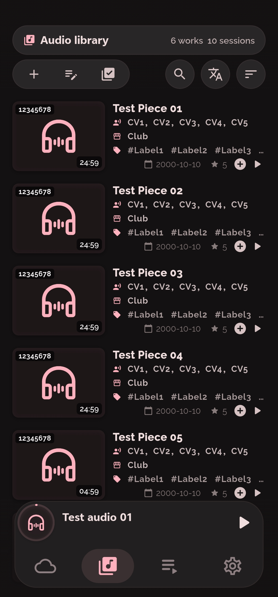
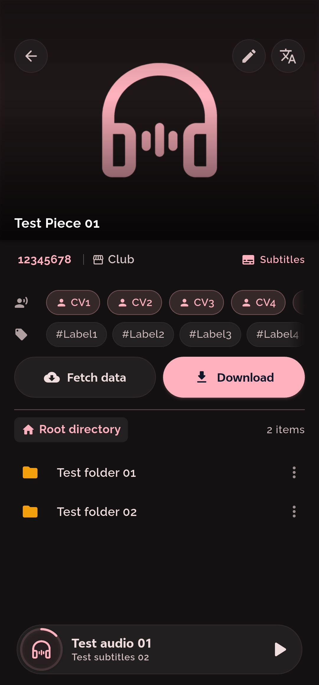
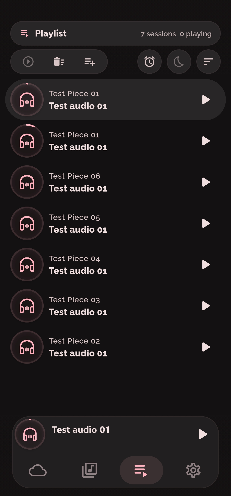
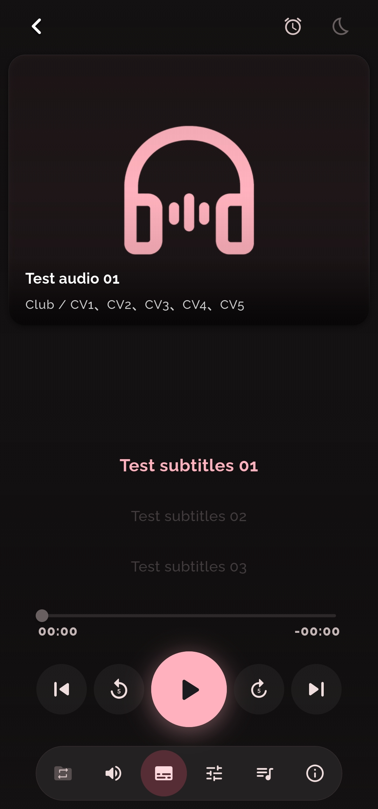
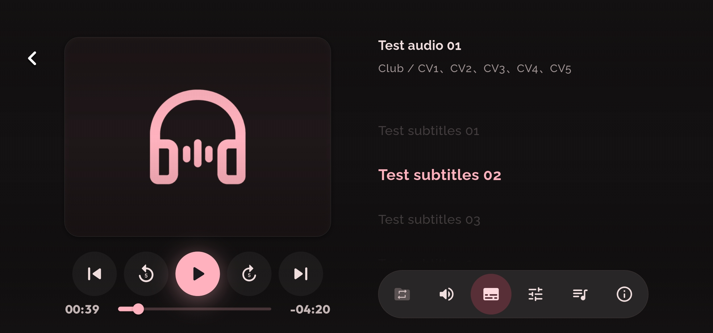

<p align="center">
  
</p>

# Doujin Audio

[简体中文](README.md) | [English](README.en.md) | [日本語](README.ja.md) | Türkçe

ASMR, doujin ses içerikleri ve yerel medya kitaplıkları için Android / Windows oynatıcı. Yerel ses ve videoları oynatın, çevrimiçi eser kataloglarından akış yapın ve indirin; bağımsız konumlar, ses düzeyi, altyazılar ve ses efektleriyle birden fazla oynatma oturumunu yönetin.

[İndir](https://github.com/NameIess-art/Doujin-Audio/releases/latest) · [Değişiklik Günlüğü](release_notes.md) · [GPL-3.0](LICENSE) · [Gizlilik Bildirimi](PRIVACY.md) · [Güvenlik Bildirimi](SECURITY.md)

[İndirme ve kurulum](#indirme-ve-kurulum) · [Ekran görüntüleri](#ekran-görüntüleri) · [Ana özellikler](#ana-özellikler) · [Windows kullanımı](#windows-kullanımı) · [Geliştirme ve sürümler](#geliştirme-ve-sürümler)

## İndirme ve kurulum

[GitHub Latest Release](https://github.com/NameIess-art/Doujin-Audio/releases/latest) sayfasından bir kurulum dosyası indirin. Android'de cihazınızın mimarisinden emin değilseniz universal sürümünü seçin. Windows, çalışma zamanı bağımlılıkları dahil olmak üzere Windows 10/11 x64'ü destekler. Her kurulum dosyası eşleşen bir `.sha256` dosyasıyla birlikte gelir.

| Platform | Kurulum Dosyası | Uyumlu Cihazlar |
| --- | --- | --- |
| Android universal | `DoujinAudio-android-universal-<tag>.apk` | arm64-v8a, armeabi-v7a ve x86_64 içerir; mimari bilinmediğinde uygundur |
| Android arm64-v8a | `DoujinAudio-android-arm64-<tag>.apk` | Çoğu modern 64-bit Android cihaz için daha küçük indirme |
| Android armeabi-v7a | `DoujinAudio-android-armv7-<tag>.apk` | Eski 32-bit ARM Android cihazlar |
| Android x86_64 | `DoujinAudio-android-x64-<tag>.apk` | x86_64 tabletler, öykünücüler ve uyumlu cihazlar |
| Windows x64 | `DoujinAudio-windows-x64-<tag>-setup.exe` | Windows 10/11; geçerli kullanıcı için kurulur |

Resmi sürümler yalnızca GitHub Releases üzerinden dağıtılır. Uygulama mağazası AAB paketleri ve iOS sürümü sağlanmaz. Geçerli sürüm [`pubspec.yaml`](pubspec.yaml) dosyasında tanımlanır.

> **Eski sürümlerden yükseltme:** Geçerli Android uygulama kimliği `com.doujin.audio` şeklindedir. Ayrı bir uygulama olarak kurulur ve yeniden adlandırma öncesi sürümlerin üzerine yazılamaz veya onların özel verilerini devralamaz. Bir `.dabackup` yedeğini geri yüklemek uyumlu bir platform ve biçim gerektirir ve veritabanı sürümü uygulamanın desteklediği sürümü aşmamalıdır. Yeniden adlandırma öncesindeki veriler ve eski yedekleme biçimleri otomatik olarak taşınmaz.

### Başlarken

1. Platformunuz için paketi kurun. Android kurulumu engellerse, APK'yı açan tarayıcıya veya dosya yöneticisine bilinmeyen uygulamaları yükleme izni verin. Windows'ta geçerli kullanıcı için kurulum yapmak üzere sihirbazı izleyin.
2. Yerel ses kitaplığına bir medya klasörü, alt klasör veya tek bir dosya ekleyin. Android yetkilendirme için SAF sistem seçicisini kullanır; Windows yerel klasörleri kullanır.
3. Ayrıntılarını görüntülemek için bir eser seçin veya oynatmak için bir ses/video öğesi seçin. Ayrıca çevrimiçi kitaplıkta ASMR.ONE ve Japanese ASMR kaynaklarına göz atabilirsiniz; ASMR.ONE hesap senkronizasyonu özellikleri oturum açmayı gerektirir.
4. Android'de çoklu seçime girmek için yerel kitaplıktaki veya çalma listelerindeki seçilebilir öğelere uzun basın ya da düzenleme eylemlerini açmak için oynatma kuyruğu öğelerini sola kaydırın. Çevrimiçi kitaplıkta eylemlerini görmek için bir eseri açın. Windows'ta sağ tıklama menülerini kullanın; yerel/çevrimiçi kitaplıkta veya çalma listelerinde sağ tıklayıp Çoklu seçim (Select multiple) seçeneğini seçerek geçerli öğeyi seçin ve diğerlerini seçmeye devam edin. Windows ana penceresini kapatmak uygulamayı sistem tepsisinde çalışır durumda tutar. Oynatmayı durdurmak ve çıkmak için tepsiden Çıkış'ı seçin.

## Ekran görüntüleri

<table>
  <tr>
    <td colspan="2" align="center" valign="top"><strong>Yerel ses kitaplığı</strong><br></td>
    <td colspan="2" align="center" valign="top"><strong>Eser ayrıntıları</strong><br></td>
    <td colspan="2" align="center" valign="top"><strong>Çalma listeleri</strong><br></td>
  </tr>
  <tr>
    <td colspan="2" align="center" valign="top"><strong>Oynatma ayrıntıları (dikey)</strong><br></td>
    <td colspan="4" align="center" valign="top"><strong>Oynatma ayrıntıları (yatay)</strong><br></td>
  </tr>
</table>

## Ana özellikler

### Oynatma ve ses efektleri

- **Birden fazla oturum ve özel kuyruklar:** Her biri sesini, konumunu, ses düzeyini, tekrar modunu, altyazılarını ve efektlerini takip eden birkaç bağımsız oturumu koruyun. Kuyrukları adlandırın, sıralayın, sürükleyerek yeniden düzenleyin ve renklendirin; oturumları toplu olarak duraklatın, sürdürün veya kaldırın. Kaydedilen oturumlar sabitlenebilir ve geçici oturumlar çoklu seçime dahil edilebilir.
- **Altı oynatma modu:** Tek parçayı tekrarla, geçerli klasörü sırayla veya karıştırarak oynat, klasörler arasında sırayla veya karıştırarak oynat ya da tek parçadan sonra durdur. Geçerli parçayı kuyruğundan kaldırmak, bitene veya siz manuel olarak parça değiştirene kadar çalmasına izin verir.
- **Oynatma denetimleri:** Yükleme veya arabelleğe alma sırasında geri bildirim ile oynat/duraklat, önceki/sonraki parça, ileri/geri sarma, hassas arama ve hata sonrası yeniden deneme.
- **Ses ayarları** arasında EQ ön ayarları ve bant kazançları, sessizlik atlama, hafif gürültü azaltma, dinamik ses dengeleme, kanal değişimi ve dengesi ile 0.25x–3.0x arasında perdeyi koruyan hız kontrolü bulunur. Android yerel EQ kullanır; Windows yazılım EQ kullanır. Stereo parçalar için kanal dengesi sayfası ayrıca kulaklıklar üzerinden sanal ön/arka konumu da ayarlar. [MIT KEMAR ölçüm verileri](assets/audio/KEMAR.md)
- **Zaman çizelgesi işaretçileri:** Noktaları veya bölümleri adlandırın ve renklendirin, seçilen bir aralığı döngüye alın. İşaretçiler yerel meta veriler ve yedeklerle birlikte kaydedilebilir.
- **Video oynatma:** Tam ekran, ekran kapalıyken ses oynatma ve Yalnızca ses modu ile oynatma ayrıntıları sayfasında video izleyin.

### Altyazılar ve senaryolar

- Aynı ada sahip altyazıları otomatik olarak eşleştirin veya manuel olarak ilişkilendirin. `.srt`, `.ass`, `.ssa`, `.vtt` ve `.lrc` biçimlerini destekler. Oynatma ayrıntıları, mini oynatıcı ve sistem yer paylaşımı zamanlama ayarları, tam zaman çizelgesi taraması ve dokunarak arama ile altyazıları birlikte gösterir.
- Altyazı yer paylaşımlarını sürükleyin ve yazı tipini, boyutunu, rengini, arka plan opaklığını ve dış çizgisini özelleştirin. Android yer paylaşımı izni gerektirir; Windows her zaman üstte kalan ayrı bir pencere kullanır.
- Yerel altyazıları içe aktarmak, seçilen dosyayı yeniden adlandırır ve sesin yanına taşır. Zaten bir altyazı dosyası varsa uygulama değiştirmeden önce sorar. Zaman çizelgesi öğelerini ekleyin, düzenleyin veya silin, silmeleri geri alın ve Android SAF dahil olmak üzere orijinal biçimde kaydetmeden önce çakışan zamanları kontrol edin.
- Senaryosu olmayan yerel Japonca sesleri çevrimdışı olarak `.srt` altyazısına dönüştürün. Uygulama birincil altyazıyı değiştirmeden önce sorar, diğer altyazıları korur ve olağan SRT adı alınmışsa ayrı bir dosya adı kullanır. Ayrıca sesle eşleştirmek ve zamanlanmış bir `.lrc` oluşturmak için Japonca bir `.txt` / `.md` senaryosu seçebilirsiniz. Geçerli zaman damgalarına sahip bir `.txt` doğrudan içe aktarılabilir. Japonca altyazılar, yerel bir çeviri modeli indirmeden veya kullanmadan Google genel çevrimiçi arayüzü aracılığıyla Çince veya İngilizceye çevrilir, zaman damgaları korunur ve iki dilli "orijinal + çeviri" SRT olarak kaydedilir.
- Her çeviri `<full-audio-filename>.translated.<target-language>.srt` (Çince için `zh-CN`, İngilizce için `en`) olarak ayrı kaydedilir; ad çakışmalarında `.2`, `.3` vb. eklenir, orijinal altyazı ve diğer çeviriler dokunulmadan bırakılır. Altyazı menüsündeki "Select subtitle" seçeneği orijinal altyazı ile her çeviri arasında geçiş yapar ve ses parçası başına seçimi hatırlar; yeni başarılı olan bir çeviri otomatik olarak etkinleştirilir.
- Altyazı çevirisi kaynak dili açıkça Japonca olarak ayarlar ve çok satırlı orijinalleri korur; her satır istek uzunluğu sınırları içinde tam bir blok olarak çevrilir. Yeni oluşturulan SRT çevirileri, uygulama içi görüntülemeden gizlenen orijinal metin sınır işaretçileri taşır, böylece yeniden çeviri önceki çevirileri tekrar çevirmek yerine yalnızca orijinal metni işler. Oluşturulan iki dilli bir altyazıyı düzenlemek, bu sınırları korurken orijinal ve çevrilmiş satırları ayrı ayrı düzenler.
- Tanıma ve çeviri sonuçları yerel sesin yanına kaydedilir; çevrimiçi ses sonuçları uygulama veri dizininde saklanır. Konuşma tanıma veya senaryo tanımanın ilk kullanımı ilgili yerel modelleri isteğe bağlı olarak indirir ve doğrular; görevler arka plan işlemeyi, ilerleme görüntülemeyi ve kesintiden sonra devam etmeyi destekler. **Çevrimdışı konuşma tanıma ve senaryo tanıma şu anda 32-bit Android'de desteklenmemektedir, ancak çevrimiçi altyazı çevirisi kullanılabilir durumdadır.** Altyazı çevirisi kaynak metni Google'a gönderir ve ağ erişimi gerektirir; bu nedenle kullanılabilirlik ağ bağlantısına, hız sınırlarına ve hizmet değişikliklerine bağlıdır; başarısızlıklar veya iptaller mevcut altyazıların üzerine yazmaz.

### Yerel medya kitaplığı

- **Klasörler ve düzenleme** — Klasör hiyerarşilerini koruyun ve eserleri seslendirmen, etiketler, çıkış tarihi, eklenme zamanı veya başlığa göre düzenleyin. Süreye göre filtreleyin, birden çok anahtar kelimeyle arama yapın, öğeleri sabitleyin, sürükleyerek yeniden düzenleyin ve öğeleri toplu olarak kuyruklara ekleyin.
- **Klasör yetkilendirmesi:** Android kalıcı SAF yetkilendirmesi kullanır ve doğrudan yol taramalarını ve tek dosya içe aktarmalarını da destekler. Windows yerel klasörleri kullanır. Taramalar kitaplığı gruplar halinde günceller.
- **Kapaklar:** Klasör görsellerinden, gömülü ses kapaklarından veya video karelerinden kapak çıkarın. Bir dosyanın kendi kapağını tercih edin veya manuel olarak bir tane seçin. Yinelenen gömülü kapaklar tekilleştirilir; WAV APIC kapakları desteklenir.
- **Eser ekleri:** Ayrıntılar sayfasında `.txt`, `.md` ve `.pdf` senaryolarını ve belgelerini okuyun. Dosyalara göz atmak, kodlamayı veya yazı tipi boyutunu değiştirmek ya da tam metni kopyalamak için metin görüntüleyicinin sağ üst menüsünü açın. PDF'ler sayfalı önizlemeler sunar.
- **Sayfa çevirisi:** Yerel ve ASMR.ONE eser ayrıntı sayfalarının sağ üst köşesinden başlıkları, çevreleri (circles), etiketleri, dizin yapılarını ve dosya adlarını çevirin; metin görüntüleyicinin sağ üst köşesinden biçimlendirmeyi, bağlantıları ve kod bloklarını koruyarak yüklenen TXT ve Markdown metinlerini çevirin (PDF çevirisi desteklenmez). Hedef dil uygulama dilini takip eder; orijinal metne dönmek için tekrar dokunun ve devam eden istekler iptal edilebilir. Çeviriler yalnızca görünümü değiştirir; eser meta verilerini, dosya yollarını veya kaynak dosyaları değiştirmez. API anahtarı gerektirmeden Google genel çevrimiçi çevirisini kullanır; çevrilecek metin Google'a gönderilir ve kullanılabilirlik ağ bağlantısına, hız sınırlarına ve hizmet düzenlemelerine bağlıdır.
- **Eser meta verileri:** Eser bilgilerini RJ koduna, dosya adına veya başlığa göre sırasıyla ASMR.ONE, DLsite ve Japanese ASMR üzerinden arayın. Önceki bir kaynak başarısız olursa veya hala eksik alanlar bırakırsa, sonraki kaynaklar yalnızca eksik alanları doldurur ve meta veriler tamamlandığında sorgular durur. Eserleri toplu olarak eşleştirin, tek tek inceleyin, sonuçları düzenleyin ve kaydetmeden önce onaylayın. RJ koduna sahip yerel eserler, geçerli eser klasörüne eksik dosyaları eklemek için çevrimiçi kitaplık indirme sayfasını doğrudan açabilir.
- **Kaldırma ve geri yükleme:** Bir kitaplık kaldırma işlemini geri alın. Kaldırılan klasörler gelecekteki taramalarda atlanır ve Kaldırılan klasörlerden geri yüklenebilir.
- **LAN paylaşımı ve WebDAV uzak kaynakları:** Windows, telefonların tarama yapmadan düzenli eserlere, kapaklara, harici altyazılara, senaryolara ve ses/videolara doğrudan göz atabilmesi ve akış yapabilmesi için Ayarlar'da isteğe bağlı bir LAN akış sunucusunu (6 haneli erişim kodu koruması, uzaktan düzenleme izni anahtarı ve aynı alt ağ UDP keşfi ile) etkinleştirebilir; her iki platform da paylaşılan arama ve sıralama, çoklu seçim toplu eylemleri, gerçek zamanlı uzak meta veri/klasör/inceleme düzenleme ve uzak eserleri yerel kitaplığa indirme özellikleriyle Yerel kitaplık başlığındaki sağ üst kaynak menüsünden yerel kitaplık, Windows LAN kaynakları ve WebDAV klasörleri (NAS veya alist gibi) arasında sorunsuzca geçiş yapabilir.

Eser bilgileri; seçilen kapak, zaman çizelgesi işaretçileri ve bölüm döngüleri dahil olmak üzere klasör içindeki `doujin-audio.json` dosyasında saklanır. Tarama içe aktarmaları ve RJ kodu tamamlama mevcut JSON'un üzerine yazmaz. Otomatik süre tamamlama diğer alanları ve öğeleri koruyarak yalnızca eksik süreleri günceller; okunamayan veya uyumsuz dosyalar değişmeden kalır. Klasör eseri işaretçileri, taşınmaların ardından geri yükleme için göreli parça yollarını kullanır ve yinelenen içe aktarmalar daha yeni işaretçileri korur.

### Çevrimiçi kitaplık ve indirmeler

- Kaynak seçmeden tek bir sayfada ASMR.ONE ve Japanese ASMR'ye göz atın ve arama yapın; aynı koda sahip eserler ASMR.ONE tercih edilerek birleştirilir. Eklenen, en son ve önerilen listeler her iki siteyi birleştirirken; satış, puan ve inceleme sıralamaları ASMR.ONE ölçümlerini kullanır. Favoriler ve geçmiş yerel olarak birlikte yönetilir ve ASMR.ONE içeriği oturum açtıktan sonra senkronize edilir.
- Japanese ASMR aramaları ve katalogları Eara (`earaasmr.com`) üzerinden alınır; oynatma ve indirmeler ise doğrudan medya sitesine bağlanır. Üçüncü taraf uç noktaları değişebilir veya geçici olarak kullanılamayabilir; bir site başarısız olursa bir bildirim gösterilir ve diğerinin sonuçları korunur. Bu uç nokta yalnızca yayın sırasını sağladığından, Japanese ASMR "Eklenme zamanı" sıralamasına yüklenen grupların eklenme tarihini kullanarak katılır ve sayfalar arası site geneli eklenme sırasını garanti etmez.
- Arama sayfasındaki popüler seslendirmenler ve etiketler Eara'nın popüler öneriler uç noktasını kullanır; önbelleğe alınmış veya paketlenmiş anlık görüntüleri hemen gösterir ve arka planda yeniler; her bölüm varsayılan olarak üç satır gösterir ve 30 öğeye kadar genişler.
- Japanese ASMR ilerleme ve parça değiştirme ile bölüm bölüm akış yapar. İndirmeler ağ hatasında sınırlı yeniden denemelerle kaynak dosya sayfasını ve gerçek URL'yi çözümler ve kaynak dosya kullanılamadığında M4A olarak kaydedilen HLS'ye geri döner. Uç nokta dosya boyutunu atladığında "Boyut bilinmiyor" gösterilir ve tamamlandığında gerçek boyut kaydedilir. Duraklatılan HLS bölümleri, kısmi yeniden çoklanmış (remuxed) dosyaları yeniden kullanmak yerine tamamlanmamış bölümü yeniden indirir.
- Orijinal klasör yapısını koruyarak tek tek parçaları, alt klasörleri veya tüm eserleri indirin. Kapaklar ayrı olarak `Cover/<RJ code>.<extension>` yoluna kaydedilir. Android SAF indirme klasörlerini; Windows yerel klasörleri kullanır.
- Tek tek görevleri veya tüm indirmeleri duraklatın, kesintiye uğrayan aktarımları sürdürün ve başarısız olanları yeniden deneyin. Eşzamanlı olarak 1–5 eser indirin ve 3–10 denemelik bir yeniden deneme sınırı (varsayılan 5) belirleyin. Görevler arka plana geçerken veya çıkmadan önce askıya alınır, ardından devam edildiğinde sürdürülür.
- Görev listesinde tüm indirmeleri duraklatma veya sürdürme denetimleri bulunur. Tamamlanan görevleri temizlemek kayıtlarını kaldırır ve dosyalarını korur. Bir eser zaten kuyruktaysa doğrudan görev listesine geçebilirsiniz.
- İndirmeleri sürdürme yalnızca aynı uzak sürüme ait olduğu doğrulanan geçici dosyaları yeniden kullanır; doğrulanamayan eski kısmi dosyalar yeniden indirilir. Oynatma sırasında otomatik önbelleğe alma yalnızca tam bir indirme uzunluk doğrulamasını geçtikten sonra etkinleştirilir ve eski otomatik önbellekler yeniden oluşturulur; tamamlanan kullanıcı indirmeleri toplu olarak yeniden oluşturulmaz.
- Eser meta verilerini kaydetme etkinleştirildiğinde, indirme görevleri eser meta verisi dil ayarını izleyerek RJ koduna göre ASMR.ONE → DLsite → Japanese ASMR arama ve boşluk doldurma akışını yeniden kullanır; tüm aramalar başarısız olursa veya RJ kodu yoksa, medya indirmeleri kesintiye uğratılmadan çevrimiçi katalog verileri korunur. Yeni `doujin-audio.json` dosyaları medya dosyaları yazılmadan önce oluşturulur ve mevcut JSON dosyalarına dokunulmaz.
- Tamamlanan eser indirmeleri halihazırda eklenmiş kitaplıkları otomatik olarak yeniler. **İndirme klasörleri kitaplığa otomatik olarak eklenmez**; bunun dışındaki eserler manuel içe aktarma gerektirir.

### Zamanlayıcılar ve arka plan oynatma

- Etkin bir geri sayımı her iki yönde 5 veya 15 dakika ayarlayın. Uyku modunda, oynatmayı duraklatmak veya sürdürmek için çift dokunun ve çıkmak için ekranı iki saniye basılı tutun.
- Bir geri sayım ayarladıktan sonra, zamanlayıcı dolduğunda her oynatma oturumunun geçerli parçası bittiğinde duraklaması için "Oynatma bittikten sonra oturumları duraklat" seçeneğini etkinleştirebilirsiniz. Duraklatmadan önce sesi kısarak kapatmayı (fade-out), önceden ayarlanmış bir zamanda otomatik sürdürmeyi ve sürdürürken sesi açmayı (fade-in) destekler.
- Android, arka plan ve ekran kapalı oynatma için yerel bir ön plan medya hizmeti kullanır. Sistem medya bildirimi oynatma denetimlerini sağlar. Uygulama kurtarılabilir oynatma hatalarını yeniden deneyebilir ve yeniden başlatma sonrasında bekleyen zamanlayıcıları geri yükleyebilir.
- Android Doze ve üretici arka plan kısıtlamaları uzun dinleme oturumlarını yine de etkileyebilir. İzinler ve arka plan altında pil optimizasyonunu ve arka plan izinlerini gözden geçirin. WakeLock'lar sistem kısıtlamalarını aşamaz.
- Windows bekleyen zamanlayıcı görevlerini geçerli kullanıcının Görev Zamanlayıcısı aracılığıyla geri yükler. Uykudan uyanma donanıma ve güç ilkesine bağlıdır. **Kapatmadan uyanma ve oturum kapalıyken oynatma desteklenmez.**

### Benim: dinleme istatistikleri, geçmiş ve ilgi alanları

Hem alt menü hem de yatay kenar çubuğu, Çalma Listeleri'nden sonra ayrı Benim ve Ayarlar girişleri sağlar. Ayarlar → Genel → Sayfa görünümü, Benim'i gizlemeye olanak tanır. Görünür durumdaki Benim veya Ayarlar sayfası başlangıç sayfası olarak ayarlanabilir. Alt menü düğmeleri kullanılabilir genişliği eşit olarak paylaşır.

- **Dinleme süresi**: Gün, hafta, ay, çeyrek veya yıla göre yerel ve çevrimiçi eserlerdeki gerçek dinleme süresini görüntüleyin. Eşzamanlı oturumlar bir kez sayılır; duraklatmalar ve arabelleğe almalar sayılmaz ve oynatma hızı geçen süreyi çarpmaz. Eski geçmiş, geçmiş dinleme toplamlarını uydurmak için kullanılmaz.
- **Çubuk grafik ve ısı haritası**: Tarih satırının sağındaki stilleri değiştirin; son seçim hatırlanır. Isı haritası kullanılabilir alanı en son dönem sağ altta olacak şekilde yedi satırlık daha büyük hücrelerle doldurur. Renk yoğunluğu temayı takip eder ve dinleme süresiyle artar.
- **Tarihler ve kesin süreler**: Seçime girmek için tarihe tıklayın ve geçmiş dönemler boyunca yatay olarak kaydırın. Tarih aralığını ve kesin süreyi görmek için bir çubuk veya hücre seçin. Windows ayrıca üzerine gelme ayrıntılarını, fareyle sürüklemeyi, tekerlek kaydırmayı ve dokunmatik yüzey kaydırmayı destekler.
- **Dinleme geçmişi**: Yerel ve çevrimiçi eserler, en yenisi ilk sırada olacak şekilde sayfa başına on tane dikey bir listede görünür. Görüntülenen aralık içinde atlamak için sayfa numarasını seçin. Bir girişi silmek için Android'de sola kaydırın veya Windows'ta sağ tıklayın, ardından geri yüklemek için Geri Al'ı kullanın. Dinleme toplamları korunur. Bir girişi seçmek eser ayrıntılarını açar ve mevcut bir yerel kopyaya öncelik verir. Yerel başlıklar yerel ad görüntüleme ayarını takip eder.
- **İlgi Alanları (Etiketler, Seslendirmenler, Çevreler)**: İlk 20 girişi görüntülemek için Benim sayfasındaki Etiketler, Seslendirmenler ve Çevreler sekmeleri arasında geçiş yapın ve adını kopyalamak için herhangi bir öğeye dokunun. Etiketlerde 20'den az giriş olduğunda, onaylanan manuel etiketler otomatik seçilen listeye eklenir ve diğer etiketler tarafından dışarı itilseler bile manuel seçim durumlarını korurlar. Manuel seçimlerin sınırı yoktur ve onaylandıktan sonra öneri tercihlerine beslenir.
- **İlgi dışı dışlamalar**: Her yönetim sayfasında hariç tutulacak etiketleri, seslendirmenleri ve çevreleri seçin veya seçimlerini kaldırın; böylece eşleşen eserler çevrimiçi kitaplık listelerinde gizlenir. Mevcut favoriler, geçmiş, indirmeler ve etkin oynatma (Benim'deki geçmiş dahil) korunur. Tam meta veriler çevrimdışı aramayı ve toplu kaydetmeyi destekler.

### Kişiselleştirme ve veri bakımı

- **Ağ hizmetleri**: DLsite, ASMR yansılarını ve Japanese ASMR'yi test edin; bir yansı seçin. Sistem/VPN, HTTP, SOCKS5 (isteğe bağlı kimlik doğrulamalı) ve özel DNS; akış, indirmeler, güncellemeler ve çeviri dahil olmak üzere uygulama içi isteklere uygulanır. Geçerli görevler devam ederken yeni bağlantılar değiştirilen ayarları kullanır. Proxy parolaları cihazda şifrelenmiş olarak kalır ve tercih yedeklemelerinden hariç tutulur.
- Açık, koyu veya sistem teması, saf siyah tema, buzlu menü çubukları, tema rengi, başlangıç sayfası, geçiş hızı, azaltılmış hareket ve kapak kod çözme kalitesi seçin. Arayüz Basitleştirilmiş Çince, İngilizce ve Japoncayı destekler.
- Android'de kulaklık bağlantısı kesildikten, geçici ses odağı kaybından veya aramalardan sonraki davranışı yapılandırın ve özel ses odağını veya diğer uygulamalarla karıştırmayı seçin.
- `.dabackup` kitaplığı, ayarları, oynatma geçmişini ve oturumlarını, zaman çizelgesi işaretçilerini ve ASMR.ONE kimlik bilgilerini tekdüze olarak yedekler. İçe aktarmada önce bütünlük ve veritabanı şema sürümü doğrulanır: aynı platformda soğuk başlatmalı tam geri yükleme (hata durumunda geri alma ve Benim'deki daha yeni yerel dinleme istatistiklerini, geçmişi ve ilgi alanlarını koruma ile) veya yeniden başlatmasız anlık artımlı birleştirme arasında seçim yapabilirsiniz; platformlar arasında (Windows ↔ Android) oynatma konumları, parça favorileri, eser dinleme durumları ve incelemeleri, cihaz başına idempotent dinleme süreleri, zaman çizelgesi işaretçileri ve ilgi tercihleri için `RJ code + relative track path` anahtarıyla otomatik olarak anlık artımlı birleştirme gerçekleştirir ve yerel yolları ve klasör izinlerini atlarken ASMR.ONE hesabınızı ve taşınabilir ayarlarınızı da senkronize etme seçeneği sunar. Dışa aktarılan yedekler şifrelenmemiş ASMR.ONE kimlik bilgileri içerebilir.
- Kalıcı kapak önbellekleme çevrimdışı erişimi destekler ve yeniden başlatmalarda korunur; yaşa veya kapasiteye göre otomatik çıkarma yapılmaz. Listeler, filtreler, sayfalandırma ve göz atma konumları yalnızca geçerli çalıştırma sırasında korunur; ayrıntıları yeniden açmak dosya ağacını tekrar yükler.
- Android depolama analizi ve seçici önbellek temizliği sağlar. Windows, İzinler ve arka plan, Önbellek ve Depolama alanı gibi mobil ayarları gizler; dahili önbellekler yine de oynatma ve indirmelere hizmet eder. Temizleme kaynak dosyaları, manuel olarak seçilen kapakları, favorileri, geçmişi ve oynatma durumunu korur.
- Sorunları bildirmeye yardımcı olmak için hassas hesap bilgileri kaldırılmış tanılama raporlarını dışa aktarın.
- **Otomatik platformlar arası senkronizasyon:** Manuel `.dabackup` içe/dışa aktarmanın yanı sıra, uzak bir kitaplığı yenilemek için aşağı çekmek LAN üzerinden otomatik olarak çift yönlü ilerleme ve istatistik senkronizasyonu gerçekleştirir ve isteğe bağlı WebDAV cihaz başına parçalar (`.dasync`) başlangıçta ve arka plana alındığında otomatik senkronize olur.

## Desteklenen biçimler

| Tür | Biçimler |
| --- | --- |
| Ses | `flac`, `wav`, `mp3`, `m4a`, `aac`, `ogg`, `opus`, `3gp` |
| Video | `mp4`, `mkv`, `webm`, `mov`, `m4v`, `avi`, `3gp` |
| Altyazılar | `.srt`, `.ass`, `.ssa`, `.vtt`, `.lrc` |
| Belgeler | `.txt` (kodlama algılama), `.md`, `.pdf` |
| Kapaklar | `jpg`, `jpeg`, `png`, `webp`, gömülü ses kapakları, video kareleri |
| Yedekler ve Senkronizasyon | `.dabackup` (aynı platformda tam geri yükleme / platformlar arası artımlı birleştirme) |

## Windows kullanımı

Ana arayüz varsayılan olarak 1280×800 ve minimum 960×600 mantıksal piksel istemci alanıyla yatay bir düzen kullanır. Pencereler yeniden boyutlandırılabilir ve ekranı kaplayabilir. Kart eylemleri için ve meta veri etiketlerini kopyalamak için sağ tıklama menülerini kullanın. Dikey sayfalar her zaman görünür kaydırma çubuklarına sahiptir. Altyazı yer paylaşımları ana pencere ön planda veya arka plandayken görünür kalır. Otomatik metin kaydırma ve yükseklik ayarlaması ile sürüklenebilir ve yatay olarak yeniden boyutlandırılabilirler. Konum ve genişlik yeniden başlatmalar arasında kaydedilir.

Ana pencereyi kapatmak sistem tepsisine küçültür. Tepsiden çıkış verileri kaydeder ve işlemi sonlandırır. Uygulama tek örnek, sistem medya denetimleri, ses çıkış aygıtı değişikliklerinin işlenmesi ve görev çubuğu küçük resim oynatma düğmelerini sağlar. Yükseltmeler kullanıcı verilerini korur; kaldırma zamanlanmış görevleri kaldırır ancak kullanıcı veri dizinini korur.

Klavye yardımını ve genel kısayol kayıt durumunu görüntülemek için `F1` tuşuna basın:

| Kapsam | Tuşlar | Eylem |
| --- | --- | --- |
| Sistem geneli (arka plan ve tepsi dahil) | `Ctrl+Alt+Space` | Oynat / duraklat |
| Sistem geneli | `Ctrl+Alt+←` / `→` | Önceki / sonraki parça |
| Sistem geneli | `Ctrl+Alt+↑` | Ana pencereyi geri yükle |
| Uygulama ön planı | `Ctrl+Space` | Oynat / duraklat |
| Uygulama ön planı | `Ctrl+←` / `→` | Önceki / sonraki parça |
| Uygulama ön planı | `Alt+←` / `→` | 5 saniye geri / ileri sar |
| Uygulama ön planı | `↑` / `↓` | Denetlenen oturumun ses düzeyini %5 artır / azalt |
| Ana arayüz | `Ctrl+1` - `Ctrl+4` | Gezinme sayfalarını görüntülenen sırayla değiştir |
| Ana arayüz | `Ctrl+Tab` / `Ctrl+Shift+Tab` | Sonraki / önceki sayfa |
| Denetimler ve menüler | `Tab` / `Shift+Tab`, `Enter` | Odağı taşı ve denetimleri etkinleştir |
| Kartlar | `Shift+F10` veya menü tuşu | Eylemleri aç |
| Menüler ve sayfalar | `↑` / `↓`, `Esc` | Öğeleri seç, menüleri kapat veya geri git |

Metin alanları düzenleme tuşlarını korur. Boşluk tuşu önce odaklanmış bir düğmeyi etkinleştirir ve hiçbir denetim kullanmıyorsa oynatmayı denetler. Başka bir uygulama tarafından alınan genel kısayollar yardımda kullanılamıyor olarak görünür. Oynatma komutları sistem medya denetimleriyle aynı oturum seçimi kurallarını kullanır.

## Uygulama içi güncellemeler ve gizlilik

Başlangıçta otomatik olarak veya ayarlardan manuel olarak GitHub Latest Release'i kontrol edin. Uygulama platform ve CPU mimarisi için bir kurulum dosyası seçer, indirme ilerlemesini gösterir ve **yalnızca SHA-256 doğrulaması geçtikten sonra** Android sistem yükleyicisini veya Windows kurulum sihirbazını başlatır. Android mimari bilinmiyorsa universal seçer. Windows x64 kurulum dosyasını seçer ve sihirbazda kurulumu onayladığınızda oynatıcının çıkmasını ister.

Kitaplık dizinleri, ayarlar ve oynatma durumu cihazda yerel olarak saklanır. Ağ erişimi çevrimiçi eser katalogları (ASMR.ONE ve ilgili medya siteleriyle Eara'nın Japanese ASMR kataloğu), DLsite meta verileri, GitHub güncellemeleri, senaryo tanıma modellerinin ilk indirmesi ve kullanıcı tarafından başlatılan sayfa ve altyazı çevirisi için kullanılır. Çevrimiçi altyazılar yüklenmeden önce yerel olarak önbelleğe alınır. Dosya erişimi ve yer paylaşımları gibi izinler özellikleri kullanıldığında istenir. Ayrıntılar için [Gizlilik Bildirimine](PRIVACY.md) bakın.

### Android izinleri

| İzin | Amaç |
| --- | --- |
| `READ_MEDIA_AUDIO` / `READ_EXTERNAL_STORAGE` | Doğrudan dosya sistemi taramaları ve geleneksel dosya seçimi |
| `MANAGE_EXTERNAL_STORAGE` | İsteğe bağlı tam depolama erişimi; SAF için gerekli değildir |
| `FOREGROUND_SERVICE_MEDIA_PLAYBACK` / `WAKE_LOCK` | Arka plan ve ekran kapalı oynatma |
| `SYSTEM_ALERT_WINDOW` | Sistem altyazı yer paylaşımı |
| `SCHEDULE_EXACT_ALARM` / `RECEIVE_BOOT_COMPLETED` | Kesin zamanlayıcılar ve yeniden başlatma sonrası görev geri yükleme |
| `REQUEST_INSTALL_PACKAGES` | Güncellemeleri indirdikten sonra sistem yükleyicisini başlatma |
| `INTERNET` | Çevrimiçi içerik, meta veri sorguları ve güncellemeler |

## Geliştirme ve sürümler

Flutter paylaşılan kullanıcı arayüzünü ve iş mantığını sağlar. Android oynatma Media3 / ExoPlayer kullanır; Windows `media_kit` / `libmpv` kullanır. Kod sorumluluğa göre düzenlenmiştir:

| Yol | Sorumluluk |
| --- | --- |
| `lib/app/` | Başlatma, bağımlılık birleştirme, yönlendirme, genel durum, temalar ve dil |
| `lib/core/` | Kalıcılık, platform ağ geçitleri, paylaşılan medya modelleri ve yeniden kullanılabilir bileşenler |
| `lib/features/` | `domain` / `application` / `presentation` olarak ayrılmış Library, Player, ASMR, Settings ve Data Support |
| `android/` | Oynatma hizmeti, kanallar, tarama, depolama, meta veriler, altyazılar ve güncellemeler |
| `windows/runner/desktop/` | Pencereler, tepsi, sistem medya denetimleri, altyazı yer paylaşımları ve zamanlanmış görevler |
| `test/`, `integration_test/` | Birim, widget ve platform entegrasyon testleri |
| `tool/` | Doğrulama, bağımlılık hazırlama, derlemeler ve kurulum betikleri |

### Yerel doğrulama

```powershell
flutter pub get
flutter analyze
flutter test
$tag = dart tool/verify_release.dart --print-tag
dart run tool/verify_release.dart --tag $tag
```

### Android Release derlemeleri

Derlemeden önce `android/key.properties` ve anahtar deposunu yapılandırın. Resmi imzalama bilgilerinin eksik olması derlemeyi durdurur; hata ayıklama imzalamasına geri dönmez.

```powershell
flutter build apk --release --obfuscate --split-debug-info=build/app/outputs/symbols
flutter build apk --release --split-per-abi --target-platform android-arm,android-arm64,android-x64 --obfuscate --split-debug-info=build/app/outputs/symbols
```

### Windows derlemeleri

Flutter 3.41.6, Visual Studio'nun C++ ile masaüstü geliştirme iş yükünü ve Windows SDK'yı kurun, ardından şunu çalıştırın:

```bat
tool\build_windows.bat
```

Birleşik betik herhangi bir çalışma dizininden çalışır, medya araçlarının ve Inno Setup'ın sabitlenmiş sürümlerini indirip doğrular, ardından Release derler ve kurulum dosyasını ve `.sha256` dosyasını `dist/windows/` dizinine çıkarır. Kurulum dosyası gerekli DLL'leri, Flutter varlıklarını ve medya araçlarını içerir; yalnızca ana EXE'yi kopyalamak yetersizdir. Windows kod imzalama varsayılan olarak yapılandırılmamıştır.

Doğrudan `flutter run -d windows` çalıştırmadan önce medya araçlarını hazırlamak için `tool\build_windows.bat -PrepareOnly` komutunu çalıştırın. `-SkipBuild` yalnızca mevcut bir Release derlemesini yeniden kullanır ve derleme doğrulamasının yerini almaz. Debug ve kurulu derlemelerin her biri kendi tek örneğini korur ve debug zamanlanmış görevleri de kurulu uygulamadan yalıtılır.

### GitHub Release

[GitHub Actions](.github/workflows/flutter.yml) statik analiz, tam Flutter test paketini, Android JVM testlerini, her iki platform için doğrulama derlemelerini ve resmi paketlemeyi çalıştırır. Resmi Sürümler Android universal, arm64, armv7 ve x64 APK'larının yanı sıra bir Windows x64 kurulum dosyası içerir. Her varlığın eşleşen bir `.sha256` dosyası vardır.

Bir etiket oluşturmadan önce sürümün `pubspec.yaml` ile eşleştiğinden emin olun ve ilgili commit için tüm ana dal CI kontrollerinin geçmesini bekleyin:

```powershell
$tag = dart tool/verify_release.dart --print-tag
dart run tool/verify_release.dart --tag $tag
git push origin main
# Wait for all main-branch CI checks to pass for this commit before creating and pushing the tag.
git tag $tag
git push origin $tag
```

Etiket iş akışı Android varlıklarını resmi imzalama anahtarlarıyla derler, imzaları, ABI'leri ve sağlama toplamlarını doğrular ve Windows kurulum dosyasını oluşturur. Tüm gerekli kontroller ve derlemeler geçtikten sonra iş akışı bir taslak Sürüm oluşturur, eksiksiz varlık kümesini doğrular ve yayımlar. [Geçerli sürüm notlarına](release_notes.md) ve [geçmiş sürümlere](https://github.com/NameIess-art/Doujin-Audio/releases) bakın.

## Projeyi destekleyin

Sürekli bakımı [Aifadian](https://ifdian.net/a/nameIess) üzerinden destekleyin. Sponsorluk tamamen gönüllüdür ve ayrıcalıkların veya ücretli özelliklerin kilidini açmaz. Tüm özellikler ücretsiz kalır.
